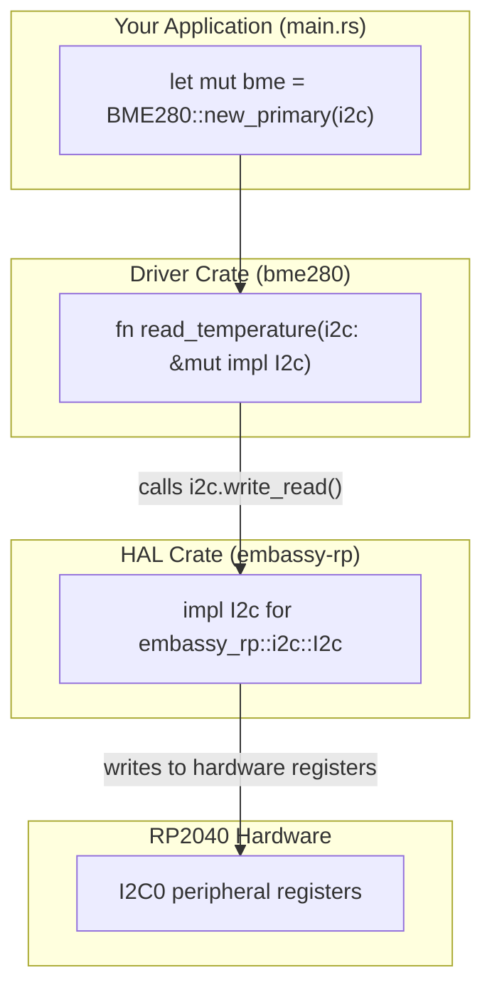

import TawkWidget from '../../../../components/TawkWidget.astro';
import UniversalContentContributors from '../../../../components/UniversalContentContributors.astro';
import InArticleAd from '../../../../components/InArticleAd.astro';
import Copyright from '../../../../components/Copyright.astro';
import BionicText from '../../../../components/BionicText.astro';
import TailwindWrapper from '../../../../components/TailwindWrapper.jsx';
import { Tabs, TabItem } from '@astrojs/starlight/components';
import { Card, CardGrid, Badge, Steps, LinkButton, FileTree } from '@astrojs/starlight/components';

<UniversalContentContributors 
  contributors={frontmatter.contributors}
/>


import EmbeddedRustRp2040Comments from '../../../../components/embedded-rust-rp2040/EmbeddedRustRp2040Comments.astro';

Your product moves from one microcontroller to another, and every sensor driver must be written and tested again, because in C each driver calls the I2C functions of one vendor by name. Rust removes this work with `embedded-hal`, a set of traits: named lists of functions that a type promises to have. The `I2c` trait says what any I2C bus can do, not how a chip does it, so a driver written for it runs unchanged on an RP2040, an STM32, an ESP32 or an nRF52. In this lesson you connect a BME280 sensor (temperature, humidity, pressure) and an SSD1306 OLED display to one I2C bus and build a small weather station from two ready-made drivers. #EmbeddedHAL #I2C #WeatherStation

## What We Are Building

<Card title="Weather Station" icon="star">
A Raspberry Pi Pico reads temperature, humidity and air pressure from a BME280 sensor and shows them on a 128x64 SSD1306 OLED display. Both devices are on the same I2C bus. A new reading appears every 2 seconds and is also logged over defmt RTT. The project uses Embassy, the async framework from [Embassy Async Fundamentals](/education/embedded-rust-rp2040/embassy-async-fundamentals/), and its HAL for the RP2040, `embassy-rp`.
</Card>

**Project specifications:**

| Parameter | Value |
|-----------|-------|
| Sensor | BME280 (temperature, humidity, pressure) |
| Display | SSD1306 128x64 OLED (I2C) |
| I2C Bus | I2C0, 400 kHz |
| I2C Pins | SDA = GP4, SCL = GP5 |
| Update Rate | Every 2 seconds |
| Log Output | defmt over RTT (through the debug probe) |
| Framework | Embassy (embassy-rp; blocking I2C in the project, async I2C shown after it) |

### Bill of Materials

| Ref | Component | Quantity | Notes |
|-----|-----------|----------|-------|
| 1 | Raspberry Pi Pico | 1 | RP2040-based board |
| 2 | BME280 breakout module | 1 | I2C address 0x76 or 0x77 (check your board) |
| 3 | SSD1306 OLED 128x64 module | 1 | I2C interface, 0.96 inch |
| 4 | Breadboard + jumper wires | 1 set | |
| 5 | USB Micro-B cable | 1 | Power for the Pico (flashing and logs go through the debug probe) |

### Wiring Table

An I2C bus has two wires: SDA carries the data and SCL carries the clock. Every device on the bus has an address, and the Pico names the address at the start of each transfer, so the BME280 (0x76) and the SSD1306 (0x3C) can share the two wires.

```text
           3.3 V
            │  │    pull-up resistors
            R  R    (on the modules)
  GP4 SDA ──┴──┼──────┬───────────┬────
  GP5 SCL ─────┴──────┼──┬────────┼──┬─
                      │  │        │  │
                   ┌──┴──┴──┐  ┌──┴──┴──┐
                   │ BME280 │  │SSD1306 │
                   │  0x76  │  │  0x3C  │
                   └────────┘  └────────┘
```

| Pico Pin | GPIO | Connection | Notes |
|----------|------|------------|-------|
| Pin 6 | GP4 | BME280 SDA, SSD1306 SDA | I2C0 data line |
| Pin 7 | GP5 | BME280 SCL, SSD1306 SCL | I2C0 clock line |
| Pin 36 | 3V3(OUT) | BME280 VIN, SSD1306 VCC | 3.3V supply |
| Pin 38 | GND | BME280 GND, SSD1306 GND | Common ground |

Most BME280 and SSD1306 breakout boards have pull-up resistors on SDA and SCL. If yours have none, add 4.7K ohm resistors from SDA to 3.3V and from SCL to 3.3V.

## The embedded-hal Trait System

<InArticleAd />


A wall socket is a standard: any appliance with the right plug works in it, whatever power station is behind the wall. `embedded-hal` is the socket standard for peripherals: no working code, only traits, lists of functions with fixed names and types. A chip's HAL promises "my I2C type has these functions"; a driver asks for "any type that has these functions". Unlike a plug, the compiler checks the match.

The `I2c` trait, simplified:

```rust
// From embedded-hal (v1.0)
pub trait I2c {
    type Error;

    fn write(&mut self, address: u8, bytes: &[u8]) -> Result<(), Self::Error>;
    fn read(&mut self, address: u8, buffer: &mut [u8]) -> Result<(), Self::Error>;
    fn write_read(
        &mut self,
        address: u8,
        write: &[u8],
        read: &mut [u8],
    ) -> Result<(), Self::Error>;
}
```

Three things in it are new for a C reader:

- `type Error;` lets each chip name its own error type. The functions return it inside a `Result`.
- `&[u8]` is a slice: a pointer and a length that travel together. There is no separate length argument to get wrong.
- `&mut self` means the function borrows the bus with the right to change it, so only one caller can use the bus at a time.

The SPI trait has one function, which runs a list of operations (write, read, transfer) with chip select held active:

```rust
pub trait SpiDevice {
    type Error;

    fn transaction(
        &mut self,
        operations: &mut [Operation<'_, u8>],
    ) -> Result<(), Self::Error>;
}
```

### How Portability Works

The code has three layers. Your application creates the bus and gives it to the driver. The driver crate (`bme280`) knows the sensor and nothing about any chip. The HAL crate (`embassy-rp`) knows the chip and nothing about any sensor.



When you write:

```rust
let mut bme = BME280::new_primary(i2c); // I2C address 0x76
```

The `BME280` struct is generic: written for a type `T` not yet known, with the condition `T: I2c` ("T has the functions of the `I2c` trait"). On an RP2040 `T` is `embassy_rp::i2c::I2c`, on an STM32 `embassy_stm32::i2c::I2c`. The driver code is the same; the compiler fills in the real type when it builds your program.

### The Async Variant: embedded-hal-async

The traits above are blocking: the CPU waits in a loop until the transfer ends. `embedded-hal-async` defines the same traits with `async fn` functions, so that a task can let other tasks run while the hardware finishes the transfer.

```rust
// From embedded-hal-async
pub trait I2c {
    type Error;

    async fn write(&mut self, address: u8, bytes: &[u8]) -> Result<(), Self::Error>;
    async fn read(&mut self, address: u8, buffer: &mut [u8]) -> Result<(), Self::Error>;
    async fn write_read(
        &mut self,
        address: u8,
        write: &[u8],
        read: &mut [u8],
    ) -> Result<(), Self::Error>;
}
```

`embassy-rp` implements both the blocking and the async `I2c` trait.

## I2C Configuration with Embassy

<InArticleAd />


The async I2C driver works with an interrupt, so you first connect the I2C0 interrupt to Embassy's handler with `bind_interrupts!`. Then you create the bus. The peripheral `p.I2C0` and the two pins are moved into the bus, so no other code can use them by mistake.

```rust
use embassy_rp::i2c::{self, Config as I2cConfig, InterruptHandler as I2cInterruptHandler};
use embassy_rp::bind_interrupts;
use embassy_rp::peripherals::I2C0;

// Bind the I2C0 interrupt to Embassy's handler
bind_interrupts!(struct Irqs {
    I2C0_IRQ => I2cInterruptHandler<I2C0>;
});

#[embassy_executor::main]
async fn main(_spawner: Spawner) {
    let p = embassy_rp::init(Default::default());

    // Configure I2C0 on GP4 (SDA) and GP5 (SCL) at 400 kHz
    let mut i2c_config = I2cConfig::default();
    i2c_config.frequency = 400_000;

    let i2c = i2c::I2c::new_async(
        p.I2C0,
        p.PIN_5,  // SCL
        p.PIN_4,  // SDA
        Irqs,
        i2c_config,
    );
}
```

Note the argument order: SCL first, then SDA. This is the order that `embassy-rp` defines for its I2C constructors.

### Scanning the I2C Bus

When a device does not answer, first find out which addresses are present on the bus. This function tries to read one byte from every valid 7-bit address and reports the ones that answer.
```rust
use embedded_hal_async::i2c::I2c as AsyncI2c;

async fn scan_i2c_bus<T: AsyncI2c>(i2c: &mut T) {
    defmt::info!("Scanning I2C bus...");
    let mut found = 0u8;

    for addr in 0x08..=0x77 {
        let mut buf = [0u8; 1];
        if i2c.read(addr, &mut buf).await.is_ok() {
            defmt::info!("  Device found at address 0x{:02X}", addr);
            found += 1;
        }
    }

    defmt::info!("Scan complete. {} device(s) found.", found);
}
```

Expected output with BME280 and SSD1306 connected:

```
Scanning I2C bus...
  Device found at address 0x3C
  Device found at address 0x76
Scan complete. 2 device(s) found.
```

Address 0x3C is the SSD1306 OLED. Address 0x76 is the BME280 (some boards use 0x77 depending on the SDO pin state).

## BME280 Driver: Reading Temperature, Humidity, Pressure

<InArticleAd />


The `bme280` crate is a ready driver for the Bosch BME280, written for the `embedded-hal` traits.

### Project Dependencies

Add these to your `Cargo.toml`:

```toml
[dependencies]
embassy-executor = { version = "0.7", features = ["arch-cortex-m", "executor-thread"] }
embassy-rp = { version = "0.3", features = ["time-driver", "rp2040", "critical-section-impl"] }
embassy-time = { version = "0.4", features = ["generic-queue-8"] }
embassy-sync = "0.6"

cortex-m = { version = "0.7", features = ["inline-asm"] }
cortex-m-rt = "0.7"
panic-halt = "1.0"
defmt = "0.3"
defmt-rtt = "0.4"

# BME280 driver (uses embedded-hal traits)
bme280 = "0.5"

# SSD1306 OLED driver
ssd1306 = "0.9"

# Graphics primitives for the display
embedded-graphics = "0.8"

# Shared I2C bus (allows multiple devices on one bus)
embedded-hal-bus = "0.2"

# embedded-hal traits (blocking and async) for the generic helper functions
embedded-hal = "1.0"
embedded-hal-async = "1.0"

portable-atomic = { version = "1.10", features = ["critical-section"] }
static_cell = "2.1"
```

### Reading the BME280

Before the first reading, the BME280 needs a start sequence: read the calibration data from its registers, set the oversampling, and set the operating mode. `init()` does all of it.

```rust
use bme280::i2c::BME280;
use embassy_time::Delay;

// Create the BME280 driver instance
// Choose the constructor that matches the I2C address of your board
let mut bme = BME280::new_primary(i2c);
// new_primary = 0x76, new_secondary = 0x77

// Initialize the sensor (reads calibration data, sets oversampling)
bme.init(&mut Delay).unwrap();

// Read all measurements in one transaction
let measurements = bme.measure(&mut Delay).unwrap();

defmt::info!("Temperature: {} C", measurements.temperature);
defmt::info!("Humidity:    {} %", measurements.humidity);
defmt::info!("Pressure:    {} hPa", measurements.pressure / 100.0);
```

The driver must wait while the sensor measures. It does not know how to wait on your chip, so it asks for a second trait, `DelayNs`. The `Delay` type from `embassy_time` has it.

### How the Same Driver Works on STM32 and ESP32

The source code of the BME280 driver names no chip. It uses only the `I2c` trait. The same driver calls on three microcontrollers:

<Tabs>
<TabItem label="RP2040 (Embassy)">

```rust
use embassy_rp::i2c;

let i2c = i2c::I2c::new_async(p.I2C0, p.PIN_5, p.PIN_4, Irqs, config);
let mut bme = BME280::new_primary(i2c);
bme.init(&mut Delay).unwrap();
let data = bme.measure(&mut Delay).unwrap();
```

</TabItem>
<TabItem label="STM32 (Embassy)">

```rust
use embassy_stm32::i2c;

let i2c = i2c::I2c::new_async(p.I2C1, p.PB6, p.PB7, Irqs, config);
let mut bme = BME280::new_primary(i2c);     // Same driver call
bme.init(&mut Delay).unwrap();               // Same init
let data = bme.measure(&mut Delay).unwrap(); // Same read
```

</TabItem>
<TabItem label="ESP32 (esp-hal)">

```rust
use esp_hal::i2c;

let i2c = i2c::I2C::new(peripherals.I2C0, io.pins.gpio21, io.pins.gpio22, 400.kHz());
let mut bme = BME280::new_primary(i2c);     // Same driver call
bme.init(&mut Delay).unwrap();               // Same init
let data = bme.measure(&mut Delay).unwrap(); // Same read
```

</TabItem>
</Tabs>

Only the line that creates the I2C bus changes. In C you would have three drivers, each built on the I2C functions of one vendor.

## SSD1306 OLED Display Driver

<InArticleAd />


The `ssd1306` crate is the driver for the display, also written for the `embedded-hal` traits. The `embedded-graphics` crate draws text, shapes and images into a buffer.

### Sharing the I2C Bus

Here ownership seems to stand in the way. `BME280::new_primary(i2c)` takes the bus by value, so it moves into the sensor driver, and passing `i2c` to the display driver then fails with "use of moved value". The compiler refuses two owners for one bus: in C, the fault of two drivers talking at the same moment.

`embedded-hal-bus` gives the answer. Put the bus in a `RefCell`, and give each driver a `RefCellDevice`, a handle that borrows the bus for one transfer only. The `RefCell` panics if two handles use the bus at the same moment, which cannot happen here: one task calls both drivers, one after the other.

```rust
use embedded_hal_bus::i2c::RefCellDevice;
use core::cell::RefCell;

// Create the I2C peripheral
let i2c = i2c::I2c::new_blocking(p.I2C0, p.PIN_5, p.PIN_4, i2c_config);

// Wrap it in a RefCell so multiple drivers can share it
let i2c_bus = RefCell::new(i2c);

// Create shared references for each device
let bme_i2c = RefCellDevice::new(&i2c_bus);
let display_i2c = RefCellDevice::new(&i2c_bus);

// Now both drivers can use the bus
let mut bme = BME280::new_primary(bme_i2c);
let mut display = build_display(display_i2c);
```

### Initializing the Display

```rust
use ssd1306::prelude::*;
use ssd1306::I2CDisplayInterface;
use ssd1306::Ssd1306;
use ssd1306::mode::BufferedGraphicsMode;
use ssd1306::size::DisplaySize128x64;
use ssd1306::rotation::DisplayRotation;

fn build_display<I: embedded_hal::i2c::I2c>(
    i2c: I,
) -> Ssd1306<I2CInterface<I>, DisplaySize128x64, BufferedGraphicsMode<DisplaySize128x64>> {
    let interface = I2CDisplayInterface::new(i2c);

    let mut display = Ssd1306::new(interface, DisplaySize128x64, DisplayRotation::Rotate0)
        .into_buffered_graphics_mode();

    display.init().unwrap();
    display.clear_buffer();
    display.flush().unwrap();

    display
}
```

### Drawing Text on the Display

You choose a text style (font, color), draw text at a position in the display buffer, and then send the buffer to the display with `flush()`. There is no `printf` and no heap in a `no_std` program, so the numbers are turned into text by hand, in fixed buffers.

One line needs a word: `fn format_f32<'a>(buf: &'a mut [u8; 32], ...) -> &'a str`. The lifetime name `'a` tells the compiler that the returned text lives inside `buf`, so the caller cannot keep it after `buf` is gone or changed. The C version returns a `char *` into the buffer, and nothing checks its use.

```rust
use embedded_graphics::mono_font::ascii::FONT_6X10;
use embedded_graphics::mono_font::MonoTextStyleBuilder;
use embedded_graphics::pixelcolor::BinaryColor;
use embedded_graphics::prelude::*;
use embedded_graphics::text::{Baseline, Text};

fn draw_readings<D: DrawTarget<Color = BinaryColor>>(
    display: &mut D,
    temperature: f32,
    humidity: f32,
    pressure: f32,
) {
    let text_style = MonoTextStyleBuilder::new()
        .font(&FONT_6X10)
        .text_color(BinaryColor::On)
        .build();

    // Clear the display
    let _ = display.clear(BinaryColor::Off);

    // Format strings (no_std, so we use fixed buffers)
    let mut temp_buf = [0u8; 32];
    let mut hum_buf = [0u8; 32];
    let mut pres_buf = [0u8; 32];

    let temp_str = format_f32(&mut temp_buf, "Temp: ", temperature, " C");
    let hum_str = format_f32(&mut hum_buf, "Hum:  ", humidity, " %");
    let pres_str = format_f32(&mut pres_buf, "Pres: ", pressure, " hPa");

    // Draw each line at a different Y position
    Text::with_baseline(temp_str, Point::new(0, 0), text_style, Baseline::Top)
        .draw(display)
        .ok();

    Text::with_baseline(hum_str, Point::new(0, 16), text_style, Baseline::Top)
        .draw(display)
        .ok();

    Text::with_baseline(pres_str, Point::new(0, 32), text_style, Baseline::Top)
        .draw(display)
        .ok();

    Text::with_baseline("SiliconWit Weather", Point::new(0, 52), text_style, Baseline::Top)
        .draw(display)
        .ok();
}

/// Format a floating-point value into a fixed buffer for no_std display.
/// Returns the formatted string slice.
fn format_f32<'a>(
    buf: &'a mut [u8; 32],
    prefix: &str,
    value: f32,
    suffix: &str,
) -> &'a str {
    let integer = value as i32;
    let decimal = ((value - integer as f32) * 10.0) as i32;
    let decimal = if decimal < 0 { -decimal } else { decimal };

    let mut pos = 0usize;

    // Write prefix
    for b in prefix.bytes() {
        if pos < buf.len() {
            buf[pos] = b;
            pos += 1;
        }
    }

    // Write integer part (handle negative, including -0.x)
    if value < 0.0 {
        if pos < buf.len() {
            buf[pos] = b'-';
            pos += 1;
        }
    }
    let abs_int = if integer < 0 { -integer } else { integer } as u32;
    pos = write_u32(buf, pos, abs_int);

    // Write decimal point and one decimal digit
    if pos < buf.len() {
        buf[pos] = b'.';
        pos += 1;
    }
    pos = write_u32(buf, pos, decimal as u32);

    // Write suffix
    for b in suffix.bytes() {
        if pos < buf.len() {
            buf[pos] = b;
            pos += 1;
        }
    }

    core::str::from_utf8(&buf[..pos]).unwrap_or("ERR")
}

fn write_u32(buf: &mut [u8; 32], start: usize, val: u32) -> usize {
    if val == 0 {
        if start < buf.len() {
            buf[start] = b'0';
            return start + 1;
        }
        return start;
    }

    let mut digits = [0u8; 10];
    let mut n = val;
    let mut count = 0;
    while n > 0 {
        digits[count] = b'0' + (n % 10) as u8;
        n /= 10;
        count += 1;
    }

    let mut pos = start;
    for i in (0..count).rev() {
        if pos < buf.len() {
            buf[pos] = digits[i];
            pos += 1;
        }
    }
    pos
}
```

## C vs Rust: I2C Driver Portability

<InArticleAd />


<Tabs>
<TabItem label="C (Platform-Specific)">

```c
// BME280 I2C read for RP2040 (Pico SDK)
// This code ONLY works on RP2040. Move to STM32? Rewrite everything.

#include "hardware/i2c.h"

#define BME280_ADDR 0x76

int bme280_read_reg(uint8_t reg, uint8_t *buf, uint8_t len) {
    // RP2040-specific: i2c_default, i2c_write_blocking, i2c_read_blocking
    int ret = i2c_write_blocking(i2c_default, BME280_ADDR, &reg, 1, true);
    if (ret < 0) return ret;
    return i2c_read_blocking(i2c_default, BME280_ADDR, buf, len, false);
}

// For STM32, you would rewrite:
// HAL_I2C_Mem_Read(&hi2c1, BME280_ADDR << 1, reg, I2C_MEMADD_SIZE_8BIT, buf, len, 100);

// For ESP32, you would rewrite again:
// i2c_cmd_handle_t cmd = i2c_cmd_link_create();
// i2c_master_start(cmd);
// i2c_master_write_byte(cmd, (BME280_ADDR << 1) | I2C_MASTER_WRITE, true);
// ...

// Three different APIs, three different driver implementations,
// three times the testing, three times the bugs.
```

</TabItem>
<TabItem label="Rust (Portable)">

```rust
// BME280 driver using embedded-hal traits
// Works on ANY MCU that implements embedded-hal::i2c::I2c

use embedded_hal::i2c::I2c;

const BME280_ADDR: u8 = 0x76;

fn bme280_read_reg<T: I2c>(
    i2c: &mut T,
    reg: u8,
    buf: &mut [u8],
) -> Result<(), T::Error> {
    // This single implementation works on:
    // - RP2040 (embassy-rp)
    // - STM32 (embassy-stm32)
    // - ESP32 (esp-hal)
    // - nRF52 (embassy-nrf)
    // - Any future MCU that implements embedded-hal
    i2c.write_read(BME280_ADDR, &[reg], buf)
}

// One driver. All platforms. Compile-time type checking.
// The generic parameter T is resolved at compile time,
// so there is zero runtime overhead from the abstraction.
```

</TabItem>
</Tabs>

For each real type in place of `T`, the compiler builds a separate copy of the function with direct calls to that chip's code (monomorphization). In C the same freedom needs a struct of function pointers and an indirect call each time; here it costs nothing at run time.

## Complete Project: Weather Station

<InArticleAd />


### Project Structure

<FileTree>
- weather-station/
  - .cargo/
    - config.toml
  - src/
    - main.rs
  - Cargo.toml
  - build.rs
  - memory.x
  - rust-toolchain.toml
</FileTree>

### Full Source Code

```rust
// src/main.rs
// Weather Station: BME280 + SSD1306 OLED on shared I2C bus

#![no_std]
#![no_main]

use core::cell::RefCell;

use embassy_executor::Spawner;
use embassy_rp::bind_interrupts;
use embassy_rp::i2c::{self, Config as I2cConfig, InterruptHandler as I2cInterruptHandler};
use embassy_rp::peripherals::I2C0;
use embassy_time::{Delay, Duration, Timer};
use {defmt_rtt as _, panic_halt as _};

// Display imports
use ssd1306::prelude::*;
use ssd1306::rotation::DisplayRotation;
use ssd1306::size::DisplaySize128x64;
use ssd1306::I2CDisplayInterface;
use ssd1306::Ssd1306;

// Graphics imports
use embedded_graphics::mono_font::ascii::FONT_6X10;
use embedded_graphics::mono_font::MonoTextStyleBuilder;
use embedded_graphics::pixelcolor::BinaryColor;
use embedded_graphics::prelude::*;
use embedded_graphics::text::{Baseline, Text};

// BME280 driver
use bme280::i2c::BME280;

// Shared I2C bus
use embedded_hal_bus::i2c::RefCellDevice;

// Bind I2C0 interrupt
bind_interrupts!(struct Irqs {
    I2C0_IRQ => I2cInterruptHandler<I2C0>;
});

// -----------------------------------------------------------
// Pin Assignments
// -----------------------------------------------------------
// GP4: I2C0 SDA (BME280 + SSD1306)
// GP5: I2C0 SCL (BME280 + SSD1306)
// BME280 I2C address: 0x76 (SDO pin low) or 0x77 (SDO pin high)
// SSD1306 I2C address: 0x3C (most modules)

// -----------------------------------------------------------
// Float-to-string formatting for no_std
// -----------------------------------------------------------

struct FmtBuf {
    buf: [u8; 32],
    pos: usize,
}

impl FmtBuf {
    fn new() -> Self {
        Self {
            buf: [0u8; 32],
            pos: 0,
        }
    }

    fn push_str(&mut self, s: &str) {
        for b in s.bytes() {
            if self.pos < self.buf.len() {
                self.buf[self.pos] = b;
                self.pos += 1;
            }
        }
    }

    fn push_u32(&mut self, val: u32) {
        if val == 0 {
            if self.pos < self.buf.len() {
                self.buf[self.pos] = b'0';
                self.pos += 1;
            }
            return;
        }
        let mut digits = [0u8; 10];
        let mut n = val;
        let mut count = 0usize;
        while n > 0 {
            digits[count] = b'0' + (n % 10) as u8;
            n /= 10;
            count += 1;
        }
        for i in (0..count).rev() {
            if self.pos < self.buf.len() {
                self.buf[self.pos] = digits[i];
                self.pos += 1;
            }
        }
    }

    fn push_f32(&mut self, prefix: &str, val: f32, suffix: &str) {
        self.push_str(prefix);
        let integer = val as i32;
        let decimal = ((val - integer as f32).abs() * 10.0) as u32;

        if val < 0.0 {
            if self.pos < self.buf.len() {
                self.buf[self.pos] = b'-';
                self.pos += 1;
            }
        }
        let abs_int = if integer < 0 { (-integer) as u32 } else { integer as u32 };
        self.push_u32(abs_int);
        if self.pos < self.buf.len() {
            self.buf[self.pos] = b'.';
            self.pos += 1;
        }
        self.push_u32(decimal);
        self.push_str(suffix);
    }

    fn as_str(&self) -> &str {
        core::str::from_utf8(&self.buf[..self.pos]).unwrap_or("ERR")
    }
}

// -----------------------------------------------------------
// Display Drawing
// -----------------------------------------------------------

fn draw_weather<D: DrawTarget<Color = BinaryColor>>(
    display: &mut D,
    temperature: f32,
    humidity: f32,
    pressure_hpa: f32,
    reading_num: u32,
) {
    let text_style = MonoTextStyleBuilder::new()
        .font(&FONT_6X10)
        .text_color(BinaryColor::On)
        .build();

    let _ = display.clear(BinaryColor::Off);

    // Title line
    Text::with_baseline("Weather Station", Point::new(15, 0), text_style, Baseline::Top)
        .draw(display)
        .ok();

    // Temperature
    let mut fb = FmtBuf::new();
    fb.push_f32("Temp: ", temperature, " C");
    Text::with_baseline(fb.as_str(), Point::new(0, 16), text_style, Baseline::Top)
        .draw(display)
        .ok();

    // Humidity
    let mut fb = FmtBuf::new();
    fb.push_f32("Hum:  ", humidity, " %");
    Text::with_baseline(fb.as_str(), Point::new(0, 28), text_style, Baseline::Top)
        .draw(display)
        .ok();

    // Pressure
    let mut fb = FmtBuf::new();
    fb.push_f32("Pres: ", pressure_hpa, " hPa");
    Text::with_baseline(fb.as_str(), Point::new(0, 40), text_style, Baseline::Top)
        .draw(display)
        .ok();

    // Reading counter
    let mut fb = FmtBuf::new();
    fb.push_str("Reading #");
    fb.push_u32(reading_num);
    Text::with_baseline(fb.as_str(), Point::new(0, 54), text_style, Baseline::Top)
        .draw(display)
        .ok();
}

// -----------------------------------------------------------
// Main
// -----------------------------------------------------------

#[embassy_executor::main]
async fn main(_spawner: Spawner) {
    let p = embassy_rp::init(Default::default());

    // Configure I2C0 at 400 kHz
    let mut i2c_config = I2cConfig::default();
    i2c_config.frequency = 400_000;

    let i2c = i2c::I2c::new_blocking(
        p.I2C0,
        p.PIN_5, // SCL
        p.PIN_4, // SDA
        i2c_config,
    );

    // Share the I2C bus between BME280 and SSD1306
    let i2c_bus = RefCell::new(i2c);

    // ---- Initialize BME280 ----
    let bme_i2c = RefCellDevice::new(&i2c_bus);
    let mut bme = BME280::new_primary(bme_i2c);

    match bme.init(&mut Delay) {
        Ok(()) => defmt::info!("BME280 initialized successfully"),
        Err(_) => {
            defmt::error!("BME280 init failed. Check wiring and I2C address.");
            loop {
                Timer::after_secs(1).await;
            }
        }
    }

    // ---- Initialize SSD1306 OLED ----
    let display_i2c = RefCellDevice::new(&i2c_bus);
    let interface = I2CDisplayInterface::new(display_i2c);
    let mut display = Ssd1306::new(interface, DisplaySize128x64, DisplayRotation::Rotate0)
        .into_buffered_graphics_mode();

    match display.init() {
        Ok(()) => defmt::info!("SSD1306 display initialized"),
        Err(_) => defmt::error!("SSD1306 init failed. Check wiring."),
    }

    display.clear_buffer();
    let _ = display.flush();

    // ---- Show startup message ----
    let text_style = MonoTextStyleBuilder::new()
        .font(&FONT_6X10)
        .text_color(BinaryColor::On)
        .build();

    Text::with_baseline("Initializing...", Point::new(10, 25), text_style, Baseline::Top)
        .draw(&mut display)
        .ok();
    let _ = display.flush();
    Timer::after_secs(1).await;

    // ---- Main sensor loop ----
    defmt::info!("Starting weather readings every 2 seconds");
    let mut reading_num: u32 = 0;

    loop {
        reading_num += 1;

        // Read BME280 (this is a blocking I2C transaction)
        match bme.measure(&mut Delay) {
            Ok(measurements) => {
                let temp = measurements.temperature;
                let hum = measurements.humidity;
                let pres = measurements.pressure / 100.0; // Pa to hPa

                // Log over defmt
                defmt::info!(
                    "#{}: T={} C, H={} %, P={} hPa",
                    reading_num,
                    temp,
                    hum,
                    pres
                );

                // Update the OLED display
                draw_weather(&mut display, temp, hum, pres, reading_num);
                let _ = display.flush();
            }
            Err(_) => {
                defmt::error!("BME280 read failed at reading #{}", reading_num);

                // Show error on display
                let _ = display.clear(BinaryColor::Off);
                Text::with_baseline(
                    "Sensor Error!",
                    Point::new(15, 25),
                    text_style,
                    Baseline::Top,
                )
                .draw(&mut display)
                .ok();
                let _ = display.flush();
            }
        }

        Timer::after(Duration::from_secs(2)).await;
    }
}
```

### Cargo.toml for the Complete Project

```toml
[package]
name = "weather-station"
version = "0.1.0"
edition = "2021"

[dependencies]
embassy-executor = { version = "0.7", features = ["arch-cortex-m", "executor-thread"] }
embassy-rp = { version = "0.3", features = ["time-driver", "rp2040", "critical-section-impl"] }
embassy-time = { version = "0.4", features = ["generic-queue-8"] }
embassy-sync = "0.6"

cortex-m = { version = "0.7", features = ["inline-asm"] }
cortex-m-rt = "0.7"
panic-halt = "1.0"
defmt = "0.3"
defmt-rtt = "0.4"

bme280 = "0.5"
ssd1306 = "0.9"
embedded-graphics = "0.8"
embedded-hal-bus = "0.2"

portable-atomic = { version = "1.10", features = ["critical-section"] }
static_cell = "2.1"

[profile.release]
opt-level = "s"
debug = true
lto = true
codegen-units = 1
```

## The embedded-hal-async Traits for Non-Blocking I/O

<InArticleAd />


The weather station uses blocking I2C, which is enough for one task. In a program with several tasks, a blocking transfer stops all of them until it ends. Async I2C lets the other tasks run during the transfer.

| Aspect | Blocking I2C | Async I2C |
|--------|-------------|-----------|
| Constructor | `I2c::new_blocking(...)` | `I2c::new_async(...)` |
| During transfer | CPU waits in a loop | CPU runs other tasks |
| Needs an interrupt | No | Yes (bind I2C0_IRQ) |

To change the weather station to async I2C, change how the bus is created:

```rust
// Async I2C requires the interrupt binding
bind_interrupts!(struct Irqs {
    I2C0_IRQ => I2cInterruptHandler<I2C0>;
});

// Use new_async instead of new_blocking
let i2c = i2c::I2c::new_async(
    p.I2C0,
    p.PIN_5,
    p.PIN_4,
    Irqs,
    i2c_config,
);
```

The driver crate must also support the `embedded-hal-async` traits, or its calls still block. Check the documentation of the crate.

## SPI Configuration

<InArticleAd />


Many sensors and displays use SPI, a faster bus with a clock line (SCK), one data line in each direction (MOSI and MISO), and a chip select line (CS) for each device. Embassy sets it up in the same way as I2C.

```rust
use embassy_rp::spi::{self, Config as SpiConfig, Spi};
use embassy_rp::gpio::{Level, Output};

// SPI0 pin configuration
// GP18: SCK
// GP19: MOSI (TX)
// GP16: MISO (RX)
// GP17: CS (manual chip select)

let mut spi_config = SpiConfig::default();
spi_config.frequency = 1_000_000; // 1 MHz

let spi = Spi::new_blocking(
    p.SPI0,
    p.PIN_18, // SCK
    p.PIN_19, // MOSI
    p.PIN_16, // MISO
    spi_config,
);

// Chip select is managed manually
let cs = Output::new(p.PIN_17, Level::High);
```

A driver that asks for the `SpiDevice` trait expects the chip select to be handled for it. `embedded-hal-bus::spi::ExclusiveDevice` joins the SPI bus and the chip select pin into one value that does this:

```rust
use embedded_hal_bus::spi::ExclusiveDevice;
use embassy_time::Delay;

let spi_device = ExclusiveDevice::new(spi, cs, Delay).unwrap();
// Pass spi_device to any driver that expects impl SpiDevice
```

:::tip[Instrument it]
The sensors of a monitoring device are read through these traits: a pressure or temperature sensor on I2C, an accelerometer or an ADC on SPI. A device that watches a machine must run for months with nobody near it, and a driver that cannot write outside its buffer helps with that. Connect the sensor and read it through the trait. With a radio added, the same code [sends its readings](/education/iot-systems/) to [siliconwit.io](https://siliconwit.io).
:::

## Production Notes

<InArticleAd />


### Sensor Calibration

Each BME280 holds correction values from the factory in its registers. The `bme280` crate reads them in `init()` and applies them to every measurement; the raw values mean nothing without them. If you write your own driver, use the compensation formulas of the Bosch datasheet (Section 8.1).

### I2C Bus Speed Considerations

| Speed | Frequency | Max Cable Length | Use Case |
|-------|-----------|-----------------|----------|
| Standard | 100 kHz | ~1 meter | Long wires, noisy environments |
| Fast | 400 kHz | ~30 cm | Breadboard projects (recommended) |
| Fast Plus | 1 MHz | ~10 cm | Short PCB traces only |

The RP2040 supports all three. On a breadboard, use 400 kHz. If readings fail now and then, go down to 100 kHz.

### Display Update Strategy

The buffer of a 128x64 display is 1024 bytes. Each byte needs 9 clock periods on the bus (8 data bits and one acknowledge bit), so one `flush()` at 400 kHz takes about 1024 × 9 / 400,000 s = 23 ms. With a new reading every 2 seconds this does not matter. For fast updates, redraw only the part that changed, or use a display on SPI, which is about 10 times faster.

### Error Handling

The short examples in this lesson call `.unwrap()` on many results, which panics on any error. In a product, decide what each error means:

```rust
match bme.measure(&mut Delay) {
    Ok(m) => {
        // Use measurements
    }
    Err(bme280::Error::Bus(_)) => {
        // I2C communication error. Sensor disconnected?
        // Try reinitializing after a delay.
        Timer::after_secs(5).await;
        let _ = bme.init(&mut Delay);
    }
    Err(bme280::Error::InvalidData) => {
        // Sensor returned garbage. Skip this reading.
    }
    Err(_) => {
        // Other error
    }
}
```

## Testing

<InArticleAd />


<Steps>
1. Wire the BME280 and SSD1306 to the Pico according to the wiring table above.

2. Build and flash:
   ```bash
   cargo build --release
   cargo run --release
   ```

3. The OLED should display "Initializing..." for 1 second, then show live readings:
   ```
   Weather Station
   Temp: 23.4 C
   Hum:  45.2 %
   Pres: 1013.2 hPa
   Reading #1
   ```

4. Breathe on the BME280 sensor. The temperature and the humidity rise within 2 to 4 seconds.

5. Take your breath away and wait. Both values fall back slowly.

6. Compare with the defmt log lines in the terminal:
   ```
   #1: T=23.4 C, H=45.2 %, P=1013.2 hPa
   #2: T=23.5 C, H=46.1 %, P=1013.2 hPa
   ```

7. If the display shows "Sensor Error!", check the wiring, then run the bus scan to see the address of the BME280 (0x76 or 0x77).

8. If the OLED stays dark, run the bus scan and check that 0x3C answers.
</Steps>

## Summary

<InArticleAd />


A driver written for the `embedded-hal` traits is written once and tested once, and it runs on any chip whose HAL has those traits. The `bme280` and `ssd1306` crates were not written for the RP2040, and they ran on the Pico with no change. One bus served two drivers through `RefCellDevice`, because ownership allows only one owner. The next lesson, [UART, DMA, and Ownership](/education/embedded-rust-rp2040/uart-dma-ownership/), uses the same ownership rules to keep a program away from a buffer while the hardware writes to it.

<EmbeddedRustRp2040Comments />


<InArticleAd />
<TawkWidget />
<Copyright />
