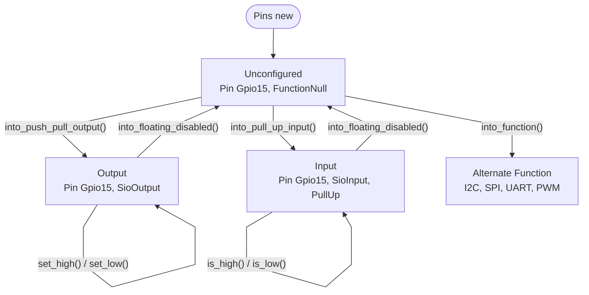

import TawkWidget from '../../../../components/TawkWidget.astro';
import UniversalContentContributors from '../../../../components/UniversalContentContributors.astro';
import InArticleAd from '../../../../components/InArticleAd.astro';
import Copyright from '../../../../components/Copyright.astro';
import BionicText from '../../../../components/BionicText.astro';
import TailwindWrapper from '../../../../components/TailwindWrapper.jsx';
import { Tabs, TabItem } from '@astrojs/starlight/components';
import { Card, CardGrid, Badge, Steps, LinkButton, FileTree } from '@astrojs/starlight/components';

<UniversalContentContributors 
  contributors={frontmatter.contributors}
/>

import EmbeddedRustRp2040Comments from '../../../../components/embedded-rust-rp2040/EmbeddedRustRp2040Comments.astro';

A status LED works on the bench and is dark in the product, because a second module, written by someone else, set the same pin as an input. In C a pin is only a number: any code can configure it, and the compiler knows nothing about its state, so such faults are found late and by hand. Rust gives the compiler three tools to find them before the program is loaded: ownership (one part of the program holds a pin), borrowing (lending it for a moment), and the typestate pattern (the state of the pin is written in its type). In this lesson you build a debounced button that switches an LED, and you see each tool at work. #Rust #Ownership #EmbeddedSystems

## What We Are Building

<Card title="Button-Toggled LED with Software Debounce" icon="star">
A push button on GP14 switches an LED on GP15, and a second button on GP16 switches a second LED on GP17. A mechanical button makes several quick contacts when pressed (bounce), so the program waits until the reading has been steady for 50 ms (debouncing). The program reads the buttons in a loop, with no interrupts.
</Card>

**Project specifications:**

| Parameter | Value |
|-----------|-------|
| Board | Raspberry Pi Pico (RP2040) |
| Button 1 | GP14, active low with internal pull-up |
| LED 1 | GP15, push-pull output |
| Button 2 | GP16, active low with internal pull-up |
| LED 2 | GP17, push-pull output |
| Debounce time | 50 ms |
| Logging | defmt over RTT |

### Bill of Materials

| Component | Quantity | Notes |
|-----------|----------|-------|
| Raspberry Pi Pico | 1 | As for the first blink |
| Debug probe | 1 | |
| Push buttons | 2 | Tactile momentary switches |
| LEDs (any color) | 2 | 3mm or 5mm |
| 220 ohm resistors | 2 | Current limiting for LEDs |
| Breadboard + jumper wires | 1 set | |

### Wiring Table

| Pico Pin | Connection | Notes |
|----------|------------|-------|
| GP14 | Button 1 (one leg) | Other leg to GND; internal pull-up enabled |
| GP15 | LED 1 anode (long leg) | Through 220 ohm resistor to GND |
| GP16 | Button 2 (one leg) | Other leg to GND; internal pull-up enabled |
| GP17 | LED 2 anode (long leg) | Through 220 ohm resistor to GND |
| GND | Button GND, LED cathodes | Common ground |

## Ownership in Rust: The Hardware Connection

<InArticleAd />

A peripheral should be used by one part of the program at a time. If two parts both send on the UART, their bytes mix. In C you prevent this with discipline and documentation. In Rust the compiler prevents it, with a rule called ownership.

Think of a room with one key. Every value in Rust (a pin, a UART, a buffer) is such a room, and exactly one variable holds its key: the owner. When you assign the value to another variable or pass it to a function, the key goes with it. This is a move, and the old variable cannot be used again. When the owner reaches the end of its scope (the closing brace of its block), the value is dropped: Rust cleans it up.

The compiler checks this while it builds the program, so ownership costs no speed and no memory at run time.

### Move Semantics

```rust
let pins = rp_pico::Pins::new(
    pac.IO_BANK0,
    pac.PADS_BANK0,
    sio.gpio_bank0,
    &mut pac.RESETS,
);

// `pins.gpio15` is a pin in its unconfigured state
let led = pins.gpio15.into_push_pull_output();
// `pins.gpio15` is MOVED into `led` and no longer exists

// This would not compile:
// let another_led = pins.gpio15.into_push_pull_output();
//                   ^^^^^^^^^^^ value used here after move
```

The method `.into_push_pull_output()` takes ownership of `pins.gpio15` and gives back the output pin `led`. If you use `pins.gpio15` again, the compiler stops with the error "use of moved value" (E0382) and points to both lines: where the value moved, and where you used it after that. The compiler is refusing a second user for one pin. That is good news: it has found, at your desk, the fault that in C appears as a dark LED in the product.

### Why This Matters for Hardware

This is the fault from the start of the lesson, written in C:

```c
// Module A: configures GP15 as a status LED output
gpio_init(15);
gpio_set_dir(15, GPIO_OUT);

// Module B (written by someone else): uses GP15 as a sensor input
gpio_init(15);  // silently reconfigures the pin!
gpio_set_dir(15, GPIO_IN);

// Module A tries to set the LED, but the pin is now an input
gpio_put(15, 1);  // does nothing, no error, no warning
```

In Rust this program cannot be written. Module A owns the pin, so module B has no value to configure.

## Typestate GPIO

<InArticleAd />

Ownership settles who may use a pin. A second C fault remains: a pin used in the wrong state, such as a write to a pin that is still an input. The typestate pattern puts the state of the pin into its type. An unconfigured pin, an output pin and an input pin are three types, each with only the functions that make sense for it. Each arrow in the diagram is a function that takes the pin in one type and returns it in another.



### Pin State Types

Read the angle brackets of a pin type as a list of facts: which pin it is, what function it has, and which pull resistor is on. A type with such parameters is a generic type. SIO is the RP2040 block for plain input and output.

```rust
use rp2040_hal::gpio::{
    Pin, FunctionSio, PullDown, PullUp, PullNone,
    bank0::Gpio15,
};

// Unconfigured pin (after Pins::new())
// Type: Pin<Gpio15, FunctionNull, PullDown>

// Configured as push-pull output
let led = pins.gpio15.into_push_pull_output();
// Type: Pin<Gpio15, FunctionSio<SioOutput>, PullDown>

// Configured as input with pull-up
let button = pins.gpio14.into_pull_up_input();
// Type: Pin<Gpio14, FunctionSio<SioInput>, PullUp>
```

### What the Compiler Prevents

```rust
// Attempt 1: read from an output pin
let led = pins.gpio15.into_push_pull_output();
let state = led.is_high();  // COMPILE ERROR: is_high() not implemented
                              // for SioOutput pins

// Attempt 2: write to an input pin
let button = pins.gpio14.into_pull_up_input();
button.set_high();  // COMPILE ERROR: set_high() not implemented
                     // for SioInput pins

// Attempt 3: use a pin before configuring it
let raw_pin = pins.gpio15;  // still FunctionNull type
raw_pin.set_high();  // COMPILE ERROR: set_high() not defined
                      // for FunctionNull pins
```

In each case the compiler reports that the function does not exist for this type of pin. It is refusing an operation that the hardware, in its present state, cannot do. In C all three compile, and the pin does nothing or does the wrong thing.

### Reconfiguring Pins

Some pins must change at run time, for example a data line that is an output and then an input. The pin moves from one type to the next:

```rust
// Start as output
let mut led = pins.gpio15.into_push_pull_output();
led.set_high().unwrap();

// Reconfigure as input (consumes the output pin, returns an input pin)
let mut sensor = led.into_pull_up_input();
let value = sensor.is_high().unwrap();

// Reconfigure back to output
let mut led = sensor.into_push_pull_output();
led.set_low().unwrap();
```

Each step takes the old value and returns a new one, so the input form and the output form of one pin never exist together.

## Button Debouncing with Ownership

<InArticleAd />

The contacts of a mechanical button bounce for 1 to 20 ms when you press it. Without debouncing, the program counts one press as 5 or 10.

```text
  pin
  high ───┐ ┌┐ ┌┐           ┌─────
          │ ││ ││           │
  low     └─┘└─┘└───────────┘
          │bounce│  steady  │
           1 to 20 ms
  raw reading:    several falling edges
  after debounce: one press
```

The debouncer below owns its state (the last steady reading and the time of the last change). It does not own the button pin: the caller lends it the pin for each reading. Lending is called borrowing and is written `&mut`.

### Debouncer Struct

```rust
use embedded_hal::digital::InputPin;

/// Software debouncer that owns its internal state.
/// The button pin is borrowed (not owned) so the caller
/// retains ownership of the hardware.
pub struct Debouncer {
    last_raw: bool,
    stable: bool,
    last_change_us: u64,
    debounce_us: u64,
}

impl Debouncer {
    /// Create a new debouncer with the given debounce period.
    pub fn new(debounce_us: u64) -> Self {
        Debouncer {
            last_raw: true,    // pull-up: released = high = true
            stable: true,
            last_change_us: 0,
            debounce_us,
        }
    }

    /// Update the debouncer with the current pin state and timestamp.
    /// Returns true if a falling edge (button press) was detected.
    pub fn update<P: InputPin>(&mut self, pin: &mut P, now_us: u64) -> bool {
        // Read the current raw state (active low: pressed = low = false)
        let raw = pin.is_high().unwrap_or(true);

        if raw != self.last_raw {
            self.last_change_us = now_us;
            self.last_raw = raw;
        }

        let elapsed = now_us.wrapping_sub(self.last_change_us);
        if elapsed >= self.debounce_us && raw != self.stable {
            let old_stable = self.stable;
            self.stable = raw;
            // Return true on falling edge (button press with pull-up)
            return old_stable && !self.stable;
        }

        false
    }

    /// Get the current debounced state.
    pub fn is_pressed(&self) -> bool {
        !self.stable  // active low with pull-up
    }
}
```

How to read this code if you come from C:

- `struct Debouncer` holds the data, and the `impl Debouncer` block holds its functions. `Debouncer` owns its fields, so no other code can change them.
- `&mut self` is the struct itself, lent to the function with permission to change it. `&self` lends it for reading only.
- `update()` borrows the pin (`pin: &mut P`), so the caller keeps the pin.
- `<P: InputPin>` makes the function generic: `P` is any type that has the functions of the `InputPin` trait, so the debouncer works with any input pin on any chip. The compiler builds one copy of `update()` for each pin type you use, with no cost at run time.

## Error Handling: Result vs C Error Codes

<InArticleAd />

In C, a function reports an error through a return code, a global flag or a special value, and nothing makes the caller look at it:

```c
// C: errors are easily ignored
int status = i2c_read(I2C0, addr, buf, len);
// What if status < 0? Nothing forces you to check.

gpio_put(15, 1);  // What if pin 15 is not initialized? No indication.
```

In Rust, a function that can fail returns `Result<T, E>`. It holds either `Ok(value)`, where the value has type `T`, or `Err(error)`, where the error has type `E`. The value is inside the `Result`, so you cannot reach it without deciding what to do about the error. If you ignore a `Result`, the compiler warns you. The usual tool is `match`, a `switch` that must cover every case:

```rust
// Rust: the compiler tracks error handling
match led.set_high() {
    Ok(()) => defmt::info!("LED on"),
    Err(e) => defmt::error!("Failed to set LED: {:?}", e),
}

// Or, for infallible operations where you know it cannot fail:
led.set_high().unwrap();  // panics if it somehow fails (documents your assumption)

// Or, to propagate errors up:
fn toggle_led<P: OutputPin>(led: &mut P) -> Result<(), P::Error> {
    led.set_high()?;  // the ? operator returns early on error
    Ok(())
}
```

### The `?` Operator

The `?` operator passes an error up to the caller. If the expression before `?` is `Err(e)`, the function returns at once with that error. If it is `Ok(v)`, you get the value `v`. It replaces the C habit of testing every return value:

```c
// C: tedious error checking
int status;
status = spi_init();
if (status != 0) return status;
status = spi_write(data, len);
if (status != 0) return status;
status = spi_read(buf, len);
if (status != 0) return status;
```

```rust
// Rust: clean error propagation
fn spi_transfer<S: SpiDevice>(spi: &mut S, data: &[u8], buf: &mut [u8])
    -> Result<(), S::Error>
{
    spi.write(data)?;
    spi.read(buf)?;
    Ok(())
}
```

## Shared Resources: Borrowing and References

<InArticleAd />

If every call moved the key, you could use a pin only once. So the owner can lend a value: the function gets a reference (a borrow), and the owner still has the value when the function returns. A reference is a pointer that the compiler has checked. It is never NULL, and it cannot outlive the value it points to. The span in which a reference is valid is its lifetime. In C you can return a pointer to a local variable, and it then points to stack memory that is gone. Rust does not compile that function.

One rule covers the two kinds of reference: at any moment a value has either any number of readers or exactly one writer.

### Immutable References (`&T`)

Several parts of the code can read a value at the same time through immutable (read-only) references:

```rust
fn print_button_state(debouncer: &Debouncer) {
    if debouncer.is_pressed() {
        defmt::info!("Button pressed");
    } else {
        defmt::info!("Button released");
    }
}

// Multiple reads are fine
let debouncer = Debouncer::new(50_000);
print_button_state(&debouncer);  // borrows debouncer
print_button_state(&debouncer);  // borrows again, no problem
// debouncer is still owned here
```

Reading a pin is different. In embedded-hal 1.0, `InputPin::is_high()` takes `&mut self`. With `&impl InputPin` the compiler stops with E0596, "cannot borrow as mutable": you asked for write access through a read-only loan. This is why `Debouncer::update()` takes `&mut P`.

### Mutable References (`&mut T`)

Only one mutable reference to a value can exist at a time, and no reader beside it:

```rust
fn toggle_led(led: &mut impl OutputPin, on: bool) {
    if on {
        led.set_high().unwrap();
    } else {
        led.set_low().unwrap();
    }
}

let mut led = pins.gpio15.into_push_pull_output();
toggle_led(&mut led, true);   // exclusive mutable borrow
toggle_led(&mut led, false);  // exclusive mutable borrow (previous one ended)
```

While `toggle_led` holds the `&mut` reference, no other code can touch the LED. Two pieces of code can therefore never change one value at the same time.

## Static Variables and the Mutex Pattern

<InArticleAd />

The main loop and an interrupt handler (ISR, interrupt service routine) often need the same variable. In C this is easy to write and easy to get wrong:

```c
// C: global mutable state (common source of bugs)
volatile int counter = 0;
volatile bool flag = false;

void TIM2_IRQHandler(void) {
    counter++;
    flag = true;
}

int main(void) {
    while (1) {
        if (flag) {
            flag = false;
            printf("Counter: %d\n", counter);
            // BUG: counter might change between the flag check and printf
        }
    }
}
```

The interrupt can fire between the test of `flag` and the read of `counter`, so the two values do not belong together. This is a data race. `volatile` only makes the compiler read the variable from memory each time. It does not keep the interrupt out.

In Rust a global variable is a `static`, and one that can change is a `static mut`. Any code can reach a `static mut` at any moment, which breaks the rule of one writer, so the compiler accepts it only inside an `unsafe` block. `unsafe` marks code where the compiler cannot check the rules and you promise that you have checked them yourself. The safe way needs no such promise.

### The Safe Pattern: Mutex with Critical Section

A critical section is a short piece of code that runs with interrupts off. Two wrappers around the data make the compiler insist on it:

- `Mutex` opens only for code that shows a token, `cs`. The only source of the token is `critical_section::with(...)`, which turns interrupts off, runs your code, and turns them on again. Your code goes between `|cs| {` and `}`: a closure, which is a function written in place.
- `RefCell` lets you change a value that is declared without `mut`, and checks the rule of one writer at run time.

```rust
use core::cell::RefCell;
use critical_section::Mutex;

// Shared state protected by a Mutex
// The Mutex ensures access only happens inside a critical section
// RefCell provides interior mutability (runtime borrow checking)
static SHARED_COUNTER: Mutex<RefCell<u32>> = Mutex::new(RefCell::new(0));
static SHARED_FLAG: Mutex<RefCell<bool>> = Mutex::new(RefCell::new(false));

// In an interrupt handler:
fn timer_interrupt() {
    critical_section::with(|cs| {
        let mut counter = SHARED_COUNTER.borrow_ref_mut(cs);
        *counter += 1;
        let mut flag = SHARED_FLAG.borrow_ref_mut(cs);
        *flag = true;
    });
}

// In the main loop:
fn check_counter() {
    critical_section::with(|cs| {
        let flag = SHARED_FLAG.borrow_ref(cs);
        if *flag {
            drop(flag);  // release the immutable borrow before mutating
            let counter = SHARED_COUNTER.borrow_ref(cs);
            defmt::info!("Counter: {}", *counter);
            let mut flag = SHARED_FLAG.borrow_ref_mut(cs);
            *flag = false;
        }
    });
}
```

The token `cs` is the proof that interrupts are off. Without it the `Mutex` gives nothing, so code that reads the shared data with interrupts on does not compile. The data race of the C version cannot be written.

<Tabs>
<TabItem label="C: volatile global">
```c
volatile uint32_t counter = 0;

void ISR(void) {
    counter++;  // no synchronization
}

int main(void) {
    // might read a torn value on 8-bit MCUs
    // might read between ISR updates on 32-bit MCUs
    printf("%d\n", counter);
}
```
</TabItem>
<TabItem label="Rust: Mutex + critical section">
```rust
static COUNTER: Mutex<RefCell<u32>> =
    Mutex::new(RefCell::new(0));

// In ISR:
critical_section::with(|cs| {
    let mut c = COUNTER.borrow_ref_mut(cs);
    *c += 1;
});

// In main:
critical_section::with(|cs| {
    let c = COUNTER.borrow_ref(cs);
    defmt::info!("{}", *c);
});
```
</TabItem>
</Tabs>

## Complete Project: Button-Toggled LED

<InArticleAd />

### Project Structure

<FileTree>
- rp2040-button-led/
  - .cargo/
    - config.toml
  - src/
    - main.rs
  - Cargo.toml
  - memory.x
  - build.rs
  - Embed.toml
</FileTree>

### Cargo.toml

```toml
[package]
name = "rp2040-button-led"
version = "0.1.0"
edition = "2021"

[dependencies]
rp2040-hal = { version = "0.10", features = ["rt", "critical-section-impl"] }
rp-pico = "0.9"
cortex-m = "0.7"
cortex-m-rt = "0.7"
panic-halt = "1.0"
defmt = "0.3"
defmt-rtt = "0.4"
embedded-hal = "1.0"

[profile.release]
codegen-units = 1
debug = 2
debug-assertions = false
incremental = false
lto = "fat"
opt-level = "s"
overflow-checks = false
```

Use the same `memory.x`, `build.rs`, `.cargo/config.toml`, and `Embed.toml` as in [the first blink project](/education/embedded-rust-rp2040/rust-toolchain-first-blink/).

### src/main.rs

```rust
//! Button-toggled LED with software debounce on the Raspberry Pi Pico.
//!
//! GP14: Button 1 (active low, internal pull-up)
//! GP15: LED 1 (push-pull output)
//! GP16: Button 2 (active low, internal pull-up)
//! GP17: LED 2 (push-pull output)
//!
//! Each button press toggles the corresponding LED.
//! Demonstrates ownership, borrowing, typestate GPIO, and Result handling.

#![no_std]
#![no_main]

use panic_halt as _;
use defmt_rtt as _;

use rp_pico::entry;
use rp_pico::hal;
use rp_pico::hal::pac;

use embedded_hal::digital::{InputPin, OutputPin};

// ---- Debouncer (ownership pattern) ----

/// Software debouncer. Owns its internal timing state.
/// Borrows the pin to read it (does not take ownership).
struct Debouncer {
    last_raw: bool,
    stable: bool,
    last_change_us: u64,
    debounce_us: u64,
}

impl Debouncer {
    fn new(debounce_us: u64) -> Self {
        Debouncer {
            last_raw: true,    // pull-up: released = high = true
            stable: true,
            last_change_us: 0,
            debounce_us,
        }
    }

    /// Update with current pin state and timestamp.
    /// Returns true on a debounced falling edge (button press).
    fn update<P: InputPin>(&mut self, pin: &mut P, now_us: u64) -> bool {
        let raw = pin.is_high().unwrap_or(true);

        if raw != self.last_raw {
            self.last_change_us = now_us;
            self.last_raw = raw;
        }

        let elapsed = now_us.wrapping_sub(self.last_change_us);
        if elapsed >= self.debounce_us && raw != self.stable {
            let old_stable = self.stable;
            self.stable = raw;
            // Falling edge: was high (released), now low (pressed)
            return old_stable && !self.stable;
        }

        false
    }
}

// ---- LED controller (borrowing pattern) ----

/// Toggle an LED. Takes a mutable reference (borrow), not ownership.
/// The caller retains ownership of the pin.
fn toggle_led<P: OutputPin>(led: &mut P, state: &mut bool) {
    *state = !*state;
    if *state {
        led.set_high().unwrap();
    } else {
        led.set_low().unwrap();
    }
}

/// Report LED state. Takes an immutable reference to the state.
fn report_state(name: &str, state: &bool) {
    if *state {
        defmt::info!("{}: ON", name);
    } else {
        defmt::info!("{}: OFF", name);
    }
}

// ---- Entry point ----

#[entry]
fn main() -> ! {
    defmt::info!("Booting rp2040-button-led");

    // Peripheral access (singleton: can only be called once)
    let mut pac = pac::Peripherals::take().unwrap();
    let mut watchdog = hal::Watchdog::new(pac.WATCHDOG);

    let clocks = hal::clocks::init_clocks_and_plls(
        rp_pico::XOSC_CRYSTAL_FREQ,
        pac.XOSC,
        pac.CLOCKS,
        pac.PLL_SYS,
        pac.PLL_USB,
        &mut pac.RESETS,
        &mut watchdog,
    )
    .ok()
    .unwrap();

    // Timer for timestamps and delays
    let timer = hal::Timer::new(pac.TIMER, &mut pac.RESETS, &clocks);

    // GPIO setup (each pin is consumed by its configuration method)
    let sio = hal::Sio::new(pac.SIO);
    let pins = rp_pico::Pins::new(
        pac.IO_BANK0,
        pac.PADS_BANK0,
        sio.gpio_bank0,
        &mut pac.RESETS,
    );

    // Configure pins using the typestate pattern.
    // Each .into_*() call CONSUMES the pin and returns a new typed pin.
    let mut button1 = pins.gpio14.into_pull_up_input();    // GP14: Button 1
    let mut led1 = pins.gpio15.into_push_pull_output(); // GP15: LED 1
    let mut button2 = pins.gpio16.into_pull_up_input();    // GP16: Button 2
    let mut led2 = pins.gpio17.into_push_pull_output(); // GP17: LED 2

    // Start with LEDs off
    led1.set_low().unwrap();
    led2.set_low().unwrap();

    // Debouncers own their state, borrow the buttons
    let mut debounce1 = Debouncer::new(50_000); // 50 ms in microseconds
    let mut debounce2 = Debouncer::new(50_000);

    // LED states (owned by main, borrowed by toggle_led)
    let mut led1_on = false;
    let mut led2_on = false;

    let mut press_count: u32 = 0;

    defmt::info!("Ready. Press buttons to toggle LEDs.");

    loop {
        let now = timer.get_counter().ticks();

        // Check button 1 (borrows button1 and debounce1 mutably)
        if debounce1.update(&mut button1, now) {
            // Toggle LED 1 (borrows led1 mutably)
            toggle_led(&mut led1, &mut led1_on);
            press_count += 1;
            defmt::info!(
                "Button 1 pressed (total: {})",
                press_count
            );
            report_state("LED 1", &led1_on);
        }

        // Check button 2 (borrows button2 and debounce2 mutably)
        if debounce2.update(&mut button2, now) {
            // Toggle LED 2 (borrows led2 mutably)
            toggle_led(&mut led2, &mut led2_on);
            press_count += 1;
            defmt::info!(
                "Button 2 pressed (total: {})",
                press_count
            );
            report_state("LED 2", &led2_on);
        }
    }
}
```

### Build and Flash

```bash
cargo run --release
```

Expected RTT output:

```
INFO  Booting rp2040-button-led
INFO  Ready. Press buttons to toggle LEDs.
INFO  Button 1 pressed (total: 1)
INFO  LED 1: ON
INFO  Button 1 pressed (total: 2)
INFO  LED 1: OFF
INFO  Button 2 pressed (total: 3)
INFO  LED 2: ON
```

### Testing Checklist

<Steps>
1. Press Button 1. LED 1 turns on. Press again. LED 1 turns off.

2. Press Button 2. LED 2 changes and LED 1 does not.

3. Press both buttons quickly, many times. Each press counts once.

4. Hold a button down. The LED changes once, at the start of the press.

5. Read the log. Each press gives exactly one "Button N pressed" line, and the total rises by one.
</Steps>

## Ownership Patterns Summary

<InArticleAd />

Choose by what the function needs: a move when it keeps the value for good (`into_push_pull_output()`), `&T` when it only reads (`report_state`), and `&mut T` when it changes the value or calls a `&mut self` function such as `is_high()` (`toggle_led`).

### Rules the Compiler Enforces

1. A value has exactly one owner. A move passes ownership on, and the old name cannot be used again.
2. A value has many readers (`&T`) or one writer (`&mut T`), never both at once.
3. A borrow must not outlive the owner. The compiler follows the lifetimes.

Applied to peripherals, these rules remove:
- A peripheral that is initialized twice, or used before it is configured
- Two modules that change one peripheral with no coordination
- A DMA buffer that is used while the hardware still writes to it (shown later with UART and DMA)

## Production Notes

<InArticleAd />

<Card title="Production Considerations" icon="setting">

**Typestate overhead:** The pin types exist only in the compiler. At run time, `pin.into_push_pull_output()` does the same register writes as the C code.

**Debounce timing:** 50 ms suits most tactile switches. Each `Debouncer` takes its own value.

**Pull-up wiring:** With `into_pull_up_input()`, the button sits between the pin and GND, not between the pin and 3.3V.

**Critical section cost:** The RP2040 has two cores. With the `critical-section-impl` feature of `rp2040-hal`, `critical_section::with()` turns interrupts off on the current core and takes a hardware spinlock, so the other core is kept out as well. Interrupts wait while the closure runs, so copy the data out of the Mutex inside the closure and process it outside.

**RefCell panics:** If you borrow mutably from a `RefCell` while another borrow is still active, the program panics. `panic-probe` shows the place over defmt.
</Card>

## What You Have Learned

<InArticleAd />

<Card title="Lesson 2 Complete" icon="approve-check">

**Ownership and borrowing:**
- One owner at a time; `.into_*()` functions move the pin
- `&T` to read, `&mut T` to change, generic functions for any pin type

**Typestate GPIO:**
- The type of a pin holds its configuration
- A write to an input or a read from an output is a compile error

**Error handling:**
- `Result<T, E>` with `match`, `unwrap()` and the `?` operator

**Shared state:**
- `Mutex<RefCell<T>>` with `critical_section::with()` for data shared with an interrupt
- Why `static mut` needs `unsafe`, and what to use in its place
</Card>

:::tip[Next Lesson]
In [Timers, PWM, and Interrupts](/education/embedded-rust-rp2040/timers-pwm-interrupts/), you drive a servo with PWM, read a potentiometer with the ADC, and use the Mutex pattern in a real interrupt handler that plays a tone on a buzzer.
:::

<EmbeddedRustRp2040Comments />

<InArticleAd />
<TawkWidget />
<Copyright />
