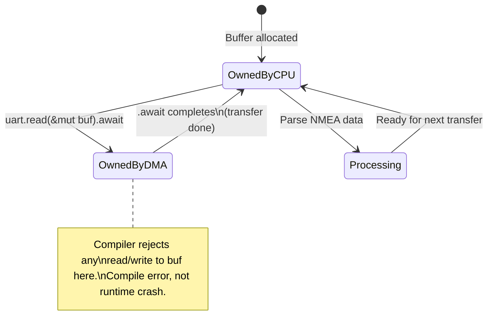

import TawkWidget from '../../../../components/TawkWidget.astro';
import UniversalContentContributors from '../../../../components/UniversalContentContributors.astro';
import InArticleAd from '../../../../components/InArticleAd.astro';
import Copyright from '../../../../components/Copyright.astro';
import BionicText from '../../../../components/BionicText.astro';
import TailwindWrapper from '../../../../components/TailwindWrapper.jsx';
import { Tabs, TabItem } from '@astrojs/starlight/components';
import { Card, CardGrid, Badge, Steps, LinkButton, FileTree } from '@astrojs/starlight/components';

<UniversalContentContributors 
  contributors={frontmatter.contributors}
/>

import EmbeddedRustRp2040Comments from '../../../../components/embedded-rust-rp2040/EmbeddedRustRp2040Comments.astro';

A GPS position is wrong once a day, and nobody can repeat the fault: the program read a buffer while the hardware was still writing into it. DMA (direct memory access) is hardware that copies bytes between a peripheral and memory with no work from the CPU. In C you give it a pointer to a buffer, and only a comment says "do not touch this buffer until the transfer is done". In Rust the buffer is given or lent to the transfer, and code that touches it too early does not compile. In this lesson you receive position data from a GPS module over a UART with DMA, check it, and turn it into latitude and longitude. #UART #DMA #Ownership



## What We Are Building

<Card title="GPS Coordinate Parser" icon="star">
A Raspberry Pi Pico receives text lines from a NEO-6M GPS module over a UART, with DMA moving the bytes. The lines follow the NMEA standard and are called sentences. The program reads two kinds, GPRMC and GPGGA, and takes latitude, longitude, altitude, speed and the number of satellites from them. It prints the position over defmt every second, and an LED shows when the module has a fix (a valid position). The receive buffer cannot be touched while a transfer is active, and the compiler checks this.
</Card>

**Project specifications:**

| Parameter | Value |
|-----------|-------|
| GPS Module | u-blox NEO-6M (9600 baud default) |
| UART | UART0, 9600 baud, 8N1 |
| UART Pins | TX = GP0, RX = GP1 |
| DMA | Automatic via Embassy async UART |
| Output | defmt over RTT (through the debug probe) |
| Update Rate | 1 Hz (GPS default output rate) |
| Framework | Embassy (embassy-rp) |

### Bill of Materials

| Ref | Component | Quantity | Notes |
|-----|-----------|----------|-------|
| 1 | Raspberry Pi Pico | 1 | RP2040-based board |
| 2 | NEO-6M GPS module | 1 | With onboard antenna, 3.3V compatible |
| 3 | LED (any color) | 1 | GPS fix indicator |
| 4 | 220 ohm resistor | 1 | LED current limiting |
| 5 | Breadboard + jumper wires | 1 set | |
| 6 | USB Micro-B cable | 1 | Power for the Pico (flashing and logs go through the debug probe) |

### Wiring Table

| Pico Pin | GPIO | Connection | Notes |
|----------|------|------------|-------|
| Pin 1 | GP0 | NEO-6M RX | Pico TX to GPS RX |
| Pin 2 | GP1 | NEO-6M TX | Pico RX from GPS TX |
| Pin 36 | 3V3(OUT) | NEO-6M VCC | 3.3V supply |
| Pin 38 | GND | NEO-6M GND | Common ground |
| Pin 20 | GP15 | LED anode (through 220 ohm) | Fix indicator |
| Pin 38 | GND | LED cathode | |

The lines cross: the TX of the NEO-6M goes to the RX of the Pico (GP1), and the RX of the NEO-6M to the TX of the Pico (GP0). TX joined to TX is the most common UART wiring mistake.

## UART Configuration with Embassy

<InArticleAd />

The async UART of `embassy-rp` uses DMA inside. A `read` or `write` starts a DMA transfer and then waits at `.await`, and other tasks run until the transfer ends.

### Basic UART Setup

```rust
use embassy_rp::uart::{self, Config as UartConfig, InterruptHandler as UartInterruptHandler};
use embassy_rp::bind_interrupts;
use embassy_rp::peripherals::UART0;

// Bind UART0 interrupt for async operation
bind_interrupts!(struct Irqs {
    UART0_IRQ => UartInterruptHandler<UART0>;
});

#[embassy_executor::main]
async fn main(_spawner: Spawner) {
    let p = embassy_rp::init(Default::default());

    // Configure UART0 at 9600 baud (GPS default)
    let mut uart_config = UartConfig::default();
    uart_config.baudrate = 9600;

    let uart = uart::Uart::new(
        p.UART0,
        p.PIN_0,  // TX
        p.PIN_1,  // RX
        Irqs,
        p.DMA_CH0, // DMA channel for TX
        p.DMA_CH1, // DMA channel for RX
        uart_config,
    );
}
```

The RP2040 has 12 DMA channels. The constructor takes two of them by value (`p.DMA_CH0`, `p.DMA_CH1`), so they move into the UART. If you pass `p.DMA_CH0` to a second peripheral, the program does not compile. In C, two drivers that are given the same channel number fight over it at run time.

### Splitting TX and RX

A GPS program needs the receive half in one task and the transmit half in another task, or not at all. `split()` turns the UART into two values:

```rust
let (tx, rx) = uart.split();

// Now tx and rx can be moved into separate tasks
spawner.spawn(gps_receiver_task(rx)).unwrap();
spawner.spawn(gps_sender_task(tx)).unwrap();
```

The split costs nothing at run time. Each task owns its half, so no task can use the other half by mistake.

## Async UART Read and Write

<InArticleAd />

### Reading Bytes

The simplest read fills a buffer and returns when the buffer is full. In the type `UartRx<'static, UART0, uart::Async>`, the word `'static` is a lifetime: it says the value is valid for the whole run of the program. A task may run forever, so everything it is given must live that long.

```rust
use embassy_rp::uart::UartRx;

#[embassy_executor::task]
async fn reader_task(mut rx: UartRx<'static, UART0, uart::Async>) {
    let mut buf = [0u8; 128];

    loop {
        // Read exactly 128 bytes. This awaits until the DMA
        // has filled the entire buffer.
        match rx.read(&mut buf).await {
            Ok(()) => {
                defmt::info!("Received {} bytes", buf.len());
            }
            Err(e) => {
                defmt::error!("UART read error: {:?}", e);
            }
        }
    }
}
```

### Reading Until a Delimiter

A GPS sentence ends with a newline character (`\n`) and its length varies, so a read of a fixed size does not fit. This UART type has no `read_until`, so the function below reads one byte at a time into a line buffer:

```rust
/// Read UART bytes into a line buffer until '\n' is found.
/// Returns the number of bytes in the line (including '\n').
async fn read_line(
    rx: &mut UartRx<'static, UART0, uart::Async>,
    line_buf: &mut [u8],
) -> Result<usize, uart::Error> {
    let mut pos = 0usize;

    loop {
        let mut byte = [0u8; 1];
        rx.read(&mut byte).await?;

        if pos < line_buf.len() {
            line_buf[pos] = byte[0];
            pos += 1;
        }

        if byte[0] == b'\n' {
            return Ok(pos);
        }

        // Safety limit: if the line is too long, return what we have
        if pos >= line_buf.len() {
            return Ok(pos);
        }
    }
}
```

### Writing Bytes

```rust
use embassy_rp::uart::UartTx;

#[embassy_executor::task]
async fn writer_task(mut tx: UartTx<'static, UART0, uart::Async>) {
    let message = b"Hello from Pico!\r\n";

    loop {
        // Write the entire message. The DMA handles the transfer.
        tx.write(message).await.unwrap();
        Timer::after_secs(1).await;
    }
}
```

## DMA and Rust Ownership: The Core Safety Guarantee

<InArticleAd />

### The Problem in C

In C, you start a DMA transfer by passing a pointer to a buffer:

```c
// C: Start DMA reception into buffer
uint8_t rx_buffer[256];
dma_channel_configure(dma_chan, &cfg,
    rx_buffer,           // Destination: raw pointer
    &uart0_hw->dr,       // Source: UART data register
    256,                 // Transfer count
    true);               // Start immediately

// WARNING: rx_buffer is now being written by DMA hardware.
// Nothing in the C language prevents you from doing this:
rx_buffer[0] = 0xFF;    // DATA CORRUPTION! DMA is still writing!
memcpy(other_buf, rx_buffer, 256);  // READING PARTIAL DATA!
printf("%s", rx_buffer);  // UNDEFINED BEHAVIOR!
```

To the C compiler `rx_buffer` is a normal array; it does not know the DMA is writing into it, so the only protection is a comment. In a project with several files and people, someone reads it too early, and the data is damaged only with certain timing.

A second fault: if `rx_buffer` is a local variable and the function returns while the transfer runs, the DMA writes into stack memory that now belongs to another function.

### The Solution in Rust

In Rust the buffer is a value with one owner, and the transfer takes it. The DMA functions of `rp2040-hal` (`rp2040_hal::dma::single_buffer`) show this most directly. They also ask for a `&'static mut` buffer, one that lives for the whole run of the program, which rules out the second fault:

```rust
// Rust (rp2040-hal DMA API): start DMA reception into a buffer.
// A `&'static mut` buffer is not `Copy`, so passing it by value moves it.
let rx_buffer: &'static mut [u8; 256] =
    cortex_m::singleton!(: [u8; 256] = [0; 256]).unwrap();

// The transfer TAKES OWNERSHIP of the DMA channel, the UART reader
// and rx_buffer. After this line, rx_buffer no longer exists in this scope.
let transfer = single_buffer::Config::new(dma.ch0, uart_rx, rx_buffer).start();

// This would NOT compile:
// rx_buffer[0] = 0xFF;
//   error[E0382]: use of moved value: `rx_buffer`

// wait() returns the channel, the reader and the buffer when the
// transfer completes. Only then can you access the data.
let (ch0, uart_rx, rx_buffer) = transfer.wait();
```

Error E0382, "use of moved value", is the compiler refusing to let you touch memory the hardware is using: the fault that takes weeks to find in C, reported with its line number before the program runs. Like a parcel handed to a courier, the buffer comes back only from `wait()`, and only then does the name `rx_buffer` exist again.

With the async UART of Embassy, the protection comes from a borrow, not a move. `read` borrows the buffer with `&mut buf`, which is exclusive: no other code can use `buf` while the task waits at `.await`. When the DMA transfer ends, the borrow ends and you can read the buffer.

```rust
let mut buf = [0u8; 256];

// During this .await, `buf` is exclusively borrowed by the UART driver.
// The compiler prevents any other access to `buf` in this scope.
rx.read(&mut buf).await.unwrap();

// Now the borrow is released. We can safely read the DMA'd data.
process_data(&buf);
```

### Why This Matters in Practice

Fast data streams use two buffers: the DMA fills one while the program reads the other, and then they change places. In C:

```c
// C double-buffer DMA: notoriously bug-prone
uint8_t buf_a[256];
uint8_t buf_b[256];
volatile int current_buf = 0;

void dma_irq_handler() {
    if (current_buf == 0) {
        // Switch DMA to buf_b
        dma_channel_set_write_addr(dma_chan, buf_b, false);
        current_buf = 1;
        // Process buf_a... but is the main loop also touching buf_a?
    } else {
        dma_channel_set_write_addr(dma_chan, buf_a, false);
        current_buf = 0;
    }
    dma_channel_start(dma_chan);
}

// Main loop
while (1) {
    if (current_buf == 1) {
        process(buf_a);  // Is DMA really done with buf_a? Race condition!
    }
}
```

The flag `current_buf` is the only coordination. The interrupt can swap the buffers between the main loop's test of the flag and its read, so the program works almost always and damages data now and then.

In Rust, each of the two buffers is a value with one owner. The program and the transfer exchange them, and the compiler checks that each buffer has one user at a time.

## GPS NMEA Sentence Parsing

<InArticleAd />

The NEO-6M sends NMEA 0183 sentences at 9600 baud, one per line. Each sentence starts with `$`, has fields separated by commas, and ends with `*XX\r\n`, where `XX` is a checksum of two hexadecimal characters. The checksum is the XOR of all characters between `$` and `*`. The receiver computes it again, and a sentence with one damaged character is rejected.

### Common NMEA Sentences

| Sentence | Description | Key Fields |
|----------|-------------|------------|
| GPRMC | Recommended minimum data | Time, status, lat, lon, speed, date |
| GPGGA | Fix information | Time, lat, lon, fix quality, satellites, altitude |

The module also sends GPVTG, GPGSA and GPGSV sentences. The parser ignores them.

### GPRMC Sentence Format

```
$GPRMC,123519,A,4807.038,N,01131.000,E,022.4,084.4,230394,003.1,W*6A
       |      | |         | |         | |     |     |      |       |
       |      | |         | |         | |     |     |      |       Checksum
       |      | |         | |         | |     |     |      Magnetic var
       |      | |         | |         | |     |     Date (DDMMYY)
       |      | |         | |         | |     Course (degrees)
       |      | |         | |         | Speed (knots)
       |      | |         | Longitude
       |      | Latitude
       |      Status (A=active, V=void)
       Time (HHMMSS)
```

The latitude `4807.038` is not 4807 degrees. The format is DDMM.MMM: two digits of degrees, then minutes. So it means 48 degrees and 07.038 minutes. One degree is 60 minutes, so in decimal degrees it is 48 + 7.038 / 60 = 48.1173 degrees. The longitude has three digits of degrees: `01131.000` is 11 + 31.000 / 60 = 11.5167 degrees.

### NMEA Parser Implementation

Two things in this code are new. A field is a slice (`&[u8]`), a pointer and a length that point into the line buffer, so no text is copied. And `split_fields<'a>` carries a lifetime name, `'a`: it tells the compiler that the fields point into `data`, so they cannot be used after the line buffer is filled again. In C the same function returns `char *` pointers into the buffer, and nothing stops the caller from reading them after the next line has arrived.

```rust
/// Parsed GPS position data
#[derive(Clone, Copy, defmt::Format)]
struct GpsPosition {
    latitude: f32,       // Decimal degrees (positive = North)
    longitude: f32,      // Decimal degrees (positive = East)
    altitude_m: f32,     // Meters above sea level
    speed_knots: f32,    // Speed over ground
    satellites: u8,      // Number of satellites used
    fix_valid: bool,     // True if GPS has a valid fix
    hours: u8,
    minutes: u8,
    seconds: u8,
}

impl GpsPosition {
    const fn empty() -> Self {
        Self {
            latitude: 0.0,
            longitude: 0.0,
            altitude_m: 0.0,
            speed_knots: 0.0,
            satellites: 0,
            fix_valid: false,
            hours: 0,
            minutes: 0,
            seconds: 0,
        }
    }
}

/// Parse an NMEA sentence and update the position if relevant.
/// Returns true if the position was updated.
fn parse_nmea(line: &[u8], pos: &mut GpsPosition) -> bool {
    // Validate minimum length and start character
    if line.len() < 10 || line[0] != b'$' {
        return false;
    }

    // Verify checksum
    if !verify_checksum(line) {
        return false;
    }

    // Extract the sentence type (e.g., "GPRMC", "GPGGA")
    let sentence_type = &line[1..6];

    if sentence_type == b"GPRMC" {
        parse_gprmc(line, pos)
    } else if sentence_type == b"GPGGA" {
        parse_gpgga(line, pos)
    } else {
        false
    }
}

/// Verify the NMEA checksum.
/// The checksum is the XOR of all bytes between '$' and '*'.
fn verify_checksum(line: &[u8]) -> bool {
    let mut checksum: u8 = 0;
    let mut found_star = false;
    let mut expected: u8 = 0;

    for (i, &byte) in line.iter().enumerate() {
        if byte == b'$' {
            continue;
        }
        if byte == b'*' {
            found_star = true;
            // Next two bytes are the hex checksum
            if i + 2 < line.len() {
                expected = hex_to_u8(line[i + 1], line[i + 2]);
            }
            break;
        }
        checksum ^= byte;
    }

    found_star && checksum == expected
}

fn hex_to_u8(high: u8, low: u8) -> u8 {
    let h = match high {
        b'0'..=b'9' => high - b'0',
        b'A'..=b'F' => high - b'A' + 10,
        b'a'..=b'f' => high - b'a' + 10,
        _ => 0,
    };
    let l = match low {
        b'0'..=b'9' => low - b'0',
        b'A'..=b'F' => low - b'A' + 10,
        b'a'..=b'f' => low - b'a' + 10,
        _ => 0,
    };
    (h << 4) | l
}

/// Split a byte slice by commas, returning an array of field slices.
/// Returns the number of fields found.
fn split_fields<'a>(
    data: &'a [u8],
    fields: &mut [&'a [u8]; 20],
) -> usize {
    let mut count = 0usize;
    let mut start = 0usize;

    for i in 0..data.len() {
        if data[i] == b',' || data[i] == b'*' {
            if count < 20 {
                fields[count] = &data[start..i];
                count += 1;
            }
            start = i + 1;
            if data[i] == b'*' {
                break;
            }
        }
    }

    count
}

/// Parse a GPRMC sentence for position, speed, and time.
fn parse_gprmc(line: &[u8], pos: &mut GpsPosition) -> bool {
    let mut fields = [&[] as &[u8]; 20];
    let count = split_fields(line, &mut fields);

    if count < 10 {
        return false;
    }

    // Field 0: sentence type ($GPRMC)
    // Field 1: time (HHMMSS.SS)
    // Field 2: status (A=active, V=void)
    // Field 3: latitude (DDMM.MMMM)
    // Field 4: N/S
    // Field 5: longitude (DDDMM.MMMM)
    // Field 6: E/W
    // Field 7: speed in knots
    // Field 8: course
    // Field 9: date (DDMMYY)

    // Check fix status
    if fields[2].is_empty() || fields[2][0] != b'A' {
        pos.fix_valid = false;
        return true; // Report "no fix" to the display task
    }

    pos.fix_valid = true;

    // Parse time
    if fields[1].len() >= 6 {
        pos.hours = parse_u8_2digit(fields[1][0], fields[1][1]);
        pos.minutes = parse_u8_2digit(fields[1][2], fields[1][3]);
        pos.seconds = parse_u8_2digit(fields[1][4], fields[1][5]);
    }

    // Parse latitude (DDMM.MMMM format)
    if fields[3].len() >= 4 {
        let degrees = parse_u8_2digit(fields[3][0], fields[3][1]) as f32;
        let minutes = parse_nmea_float(fields[3]);
        let minutes_val = minutes - (degrees * 100.0);
        pos.latitude = degrees + minutes_val / 60.0;

        if !fields[4].is_empty() && fields[4][0] == b'S' {
            pos.latitude = -pos.latitude;
        }
    }

    // Parse longitude (DDDMM.MMMM format)
    if fields[5].len() >= 5 {
        let degrees_str = &fields[5][..3];
        let degrees = parse_u8_3digit(degrees_str) as f32;
        let minutes = parse_nmea_float(fields[5]);
        let minutes_val = minutes - (degrees * 100.0);
        pos.longitude = degrees + minutes_val / 60.0;

        if !fields[6].is_empty() && fields[6][0] == b'W' {
            pos.longitude = -pos.longitude;
        }
    }

    // Parse speed in knots
    if !fields[7].is_empty() {
        pos.speed_knots = parse_nmea_float(fields[7]);
    }

    true
}

/// Parse a GPGGA sentence for altitude and satellite count.
fn parse_gpgga(line: &[u8], pos: &mut GpsPosition) -> bool {
    let mut fields = [&[] as &[u8]; 20];
    let count = split_fields(line, &mut fields);

    if count < 10 {
        return false;
    }

    // Field 0: sentence type ($GPGGA)
    // Field 6: fix quality (0=invalid, 1=GPS fix, 2=DGPS fix)
    // Field 7: number of satellites
    // Field 9: altitude in meters

    // Fix quality
    if fields[6].is_empty() || fields[6][0] == b'0' {
        return false;
    }

    // Number of satellites
    if !fields[7].is_empty() {
        pos.satellites = parse_u8_field(fields[7]);
    }

    // Altitude
    if !fields[9].is_empty() {
        pos.altitude_m = parse_nmea_float(fields[9]);
    }

    true
}

// -----------------------------------------------------------
// Numeric parsing helpers (no_std, no alloc)
// -----------------------------------------------------------

fn parse_u8_2digit(high: u8, low: u8) -> u8 {
    (high.wrapping_sub(b'0')) * 10 + (low.wrapping_sub(b'0'))
}

fn parse_u8_3digit(s: &[u8]) -> u16 {
    if s.len() < 3 {
        return 0;
    }
    let h = s[0].wrapping_sub(b'0') as u16;
    let m = s[1].wrapping_sub(b'0') as u16;
    let l = s[2].wrapping_sub(b'0') as u16;
    h * 100 + m * 10 + l
}

fn parse_u8_field(s: &[u8]) -> u8 {
    let mut val = 0u8;
    for &b in s {
        if b >= b'0' && b <= b'9' {
            val = val.wrapping_mul(10).wrapping_add(b - b'0');
        } else {
            break;
        }
    }
    val
}

/// Parse a float from a byte slice (e.g., "4807.038" or "22.4").
/// Simple implementation for NMEA fields; handles integer and one decimal part.
fn parse_nmea_float(s: &[u8]) -> f32 {
    let mut integer_part: i32 = 0;
    let mut decimal_part: i32 = 0;
    let mut decimal_divisor: f32 = 1.0;
    let mut in_decimal = false;
    let mut negative = false;

    for &b in s {
        if b == b'-' {
            negative = true;
        } else if b == b'.' {
            in_decimal = true;
        } else if b >= b'0' && b <= b'9' {
            if in_decimal {
                decimal_part = decimal_part * 10 + (b - b'0') as i32;
                decimal_divisor *= 10.0;
            } else {
                integer_part = integer_part * 10 + (b - b'0') as i32;
            }
        }
    }

    let val = integer_part as f32 + decimal_part as f32 / decimal_divisor;
    if negative { -val } else { val }
}
```

## C vs Rust: DMA Buffer Safety

<InArticleAd />

<Tabs>
<TabItem label="C (Raw Pointers)">

```c
// C DMA UART reception: the buffer is just a pointer.
// Nothing prevents access during an active transfer.

#include "hardware/dma.h"
#include "hardware/uart.h"

#define BUF_SIZE 256
uint8_t dma_buffer[BUF_SIZE];
volatile bool dma_complete = false;

void dma_irq_handler() {
    dma_hw->ints0 = 1u << dma_chan;
    dma_complete = true;
    // But what if main() already started reading dma_buffer
    // before this flag was set? Race condition.
}

void start_dma_uart_rx() {
    dma_channel_configure(dma_chan, &cfg,
        dma_buffer,          // dest: raw pointer, no protection
        &uart0_hw->dr,       // source: UART data register
        BUF_SIZE,
        true);               // start

    // From here until dma_irq_handler fires:
    // - dma_buffer is being written by hardware
    // - C allows: dma_buffer[0] = 0; (compiles fine, corrupts data)
    // - C allows: memcpy(out, dma_buffer, 256); (reads partial data)
    // - C allows: printf("%s", dma_buffer); (undefined behavior)
    //
    // The ONLY protection is this comment and the volatile flag.
    // A developer on the team who did not read this file will
    // access the buffer and introduce a subtle, intermittent bug.
}

void main_loop() {
    start_dma_uart_rx();

    while (1) {
        if (dma_complete) {
            dma_complete = false;
            process(dma_buffer);   // Usually safe. Usually.
            start_dma_uart_rx();
            // What if process() is slow and DMA finishes during it?
            // dma_buffer is being overwritten while process() reads it.
        }
        // Any code here can accidentally touch dma_buffer.
        // The compiler will not warn.
    }
}
```

</TabItem>
<TabItem label="Rust (Ownership Transfer)">

```rust
// Rust DMA UART reception: the buffer is BORROWED exclusively by the read.
// The compiler prevents access during an active transfer.

use embassy_rp::uart::{self, UartRx};

#[embassy_executor::task]
async fn receiver_task(mut rx: UartRx<'static, UART0, uart::Async>) {
    let mut buf = [0u8; 256];

    loop {
        // rx.read() borrows `buf` exclusively.
        // During this .await, `buf` cannot be accessed.
        //
        // Attempting to read buf[0] here would be a compile error:
        //   "cannot use `buf[_]` because it was mutably borrowed"
        //
        // This is not a runtime check. This is not a flag.
        // This is the compiler proving your code is correct.
        rx.read(&mut buf).await.unwrap();

        // .await returned, so the borrow is released.
        // DMA is guaranteed complete. Safe to read.
        process(&buf);

        // Even in a multi-task system, no other task can
        // access `buf` because it is a local variable.
        // Ownership is enforced at compile time.
    }
}

// Attempting to share the buffer with another task:
// let shared = &buf;
// spawner.spawn(other_task(shared));
//   error[E0597]: `buf` does not live long enough
//   error[E0502]: cannot borrow `buf` as mutable because it is
//          also borrowed as immutable
```

</TabItem>
</Tabs>

The C version depends on a `volatile bool` flag and on every programmer reading the comment. In the Rust version, a second user of the buffer during the transfer cannot be written. The two errors at the end of the Rust tab say why. E0597, "does not live long enough", refuses a pointer to data that will be gone: `buf` is a local variable of this task, and the other task may run longer. E0502 refuses a reader while a writer holds the buffer.

## Complete Project: GPS Coordinate Parser

<InArticleAd />

### Project Structure

<FileTree>
- gps-parser/
  - .cargo/
    - config.toml
  - src/
    - main.rs
  - Cargo.toml
  - build.rs
  - memory.x
  - rust-toolchain.toml
</FileTree>

### Full Source Code

The program has two tasks. The receiver task reads and parses sentences. The display task prints the position and drives the LED. They do not share a variable. The receiver puts each new position into a `Signal`, a mailbox with one place that always holds the newest value, and the display task waits for it.

```rust
// src/main.rs
// GPS NMEA parser with async UART DMA reception

#![no_std]
#![no_main]

use embassy_executor::Spawner;
use embassy_rp::bind_interrupts;
use embassy_rp::gpio::{Level, Output};
use embassy_rp::peripherals::UART0;
use embassy_rp::uart::{self, Config as UartConfig, InterruptHandler as UartInterruptHandler};
use embassy_rp::uart::{UartRx, UartTx};
use embassy_sync::blocking_mutex::raw::CriticalSectionRawMutex;
use embassy_sync::signal::Signal;
use embassy_time::{Duration, Timer};
use {defmt_rtt as _, panic_halt as _};

// Bind UART0 interrupt
bind_interrupts!(struct Irqs {
    UART0_IRQ => UartInterruptHandler<UART0>;
});

// -----------------------------------------------------------
// Shared State
// -----------------------------------------------------------

/// Signal to pass the latest GPS position from receiver to display task
static GPS_SIGNAL: Signal<CriticalSectionRawMutex, GpsPosition> = Signal::new();

// -----------------------------------------------------------
// GPS Data Types
// -----------------------------------------------------------

#[derive(Clone, Copy, defmt::Format)]
struct GpsPosition {
    latitude: f32,
    longitude: f32,
    altitude_m: f32,
    speed_knots: f32,
    satellites: u8,
    fix_valid: bool,
    hours: u8,
    minutes: u8,
    seconds: u8,
}

impl GpsPosition {
    const fn empty() -> Self {
        Self {
            latitude: 0.0,
            longitude: 0.0,
            altitude_m: 0.0,
            speed_knots: 0.0,
            satellites: 0,
            fix_valid: false,
            hours: 0,
            minutes: 0,
            seconds: 0,
        }
    }
}

// -----------------------------------------------------------
// NMEA Parser Functions
// -----------------------------------------------------------

fn verify_checksum(line: &[u8]) -> bool {
    let mut checksum: u8 = 0;
    let mut found_star = false;
    let mut expected: u8 = 0;

    for (i, &byte) in line.iter().enumerate() {
        if byte == b'$' {
            continue;
        }
        if byte == b'*' {
            found_star = true;
            if i + 2 < line.len() {
                expected = hex_to_u8(line[i + 1], line[i + 2]);
            }
            break;
        }
        checksum ^= byte;
    }

    found_star && checksum == expected
}

fn hex_to_u8(high: u8, low: u8) -> u8 {
    let h = match high {
        b'0'..=b'9' => high - b'0',
        b'A'..=b'F' => high - b'A' + 10,
        b'a'..=b'f' => high - b'a' + 10,
        _ => 0,
    };
    let l = match low {
        b'0'..=b'9' => low - b'0',
        b'A'..=b'F' => low - b'A' + 10,
        b'a'..=b'f' => low - b'a' + 10,
        _ => 0,
    };
    (h << 4) | l
}

fn split_fields<'a>(data: &'a [u8], fields: &mut [&'a [u8]; 20]) -> usize {
    let mut count = 0usize;
    let mut start = 0usize;

    for i in 0..data.len() {
        if data[i] == b',' || data[i] == b'*' {
            if count < 20 {
                fields[count] = &data[start..i];
                count += 1;
            }
            start = i + 1;
            if data[i] == b'*' {
                break;
            }
        }
    }

    count
}

fn parse_u8_2digit(high: u8, low: u8) -> u8 {
    (high.wrapping_sub(b'0')) * 10 + (low.wrapping_sub(b'0'))
}

fn parse_u8_3digit(s: &[u8]) -> u16 {
    if s.len() < 3 {
        return 0;
    }
    (s[0].wrapping_sub(b'0') as u16) * 100
        + (s[1].wrapping_sub(b'0') as u16) * 10
        + (s[2].wrapping_sub(b'0') as u16)
}

fn parse_u8_field(s: &[u8]) -> u8 {
    let mut val = 0u8;
    for &b in s {
        if b >= b'0' && b <= b'9' {
            val = val.wrapping_mul(10).wrapping_add(b - b'0');
        } else {
            break;
        }
    }
    val
}

fn parse_nmea_float(s: &[u8]) -> f32 {
    let mut integer_part: i32 = 0;
    let mut decimal_part: i32 = 0;
    let mut decimal_divisor: f32 = 1.0;
    let mut in_decimal = false;
    let mut negative = false;

    for &b in s {
        if b == b'-' {
            negative = true;
        } else if b == b'.' {
            in_decimal = true;
        } else if b >= b'0' && b <= b'9' {
            if in_decimal {
                decimal_part = decimal_part * 10 + (b - b'0') as i32;
                decimal_divisor *= 10.0;
            } else {
                integer_part = integer_part * 10 + (b - b'0') as i32;
            }
        }
    }

    let val = integer_part as f32 + decimal_part as f32 / decimal_divisor;
    if negative { -val } else { val }
}

fn parse_gprmc(line: &[u8], pos: &mut GpsPosition) -> bool {
    let mut fields = [&[] as &[u8]; 20];
    let count = split_fields(line, &mut fields);

    if count < 10 {
        return false;
    }

    if fields[2].is_empty() || fields[2][0] != b'A' {
        pos.fix_valid = false;
        return true; // Report "no fix" to the display task
    }

    pos.fix_valid = true;

    // Time
    if fields[1].len() >= 6 {
        pos.hours = parse_u8_2digit(fields[1][0], fields[1][1]);
        pos.minutes = parse_u8_2digit(fields[1][2], fields[1][3]);
        pos.seconds = parse_u8_2digit(fields[1][4], fields[1][5]);
    }

    // Latitude
    if fields[3].len() >= 4 {
        let degrees = parse_u8_2digit(fields[3][0], fields[3][1]) as f32;
        let raw = parse_nmea_float(fields[3]);
        let minutes_val = raw - (degrees * 100.0);
        pos.latitude = degrees + minutes_val / 60.0;

        if !fields[4].is_empty() && fields[4][0] == b'S' {
            pos.latitude = -pos.latitude;
        }
    }

    // Longitude
    if fields[5].len() >= 5 {
        let degrees = parse_u8_3digit(&fields[5][..3]) as f32;
        let raw = parse_nmea_float(fields[5]);
        let minutes_val = raw - (degrees * 100.0);
        pos.longitude = degrees + minutes_val / 60.0;

        if !fields[6].is_empty() && fields[6][0] == b'W' {
            pos.longitude = -pos.longitude;
        }
    }

    // Speed
    if !fields[7].is_empty() {
        pos.speed_knots = parse_nmea_float(fields[7]);
    }

    true
}

fn parse_gpgga(line: &[u8], pos: &mut GpsPosition) -> bool {
    let mut fields = [&[] as &[u8]; 20];
    let count = split_fields(line, &mut fields);

    if count < 10 {
        return false;
    }

    if fields[6].is_empty() || fields[6][0] == b'0' {
        return false;
    }

    if !fields[7].is_empty() {
        pos.satellites = parse_u8_field(fields[7]);
    }

    if !fields[9].is_empty() {
        pos.altitude_m = parse_nmea_float(fields[9]);
    }

    true
}

fn parse_nmea(line: &[u8], pos: &mut GpsPosition) -> bool {
    if line.len() < 10 || line[0] != b'$' {
        return false;
    }

    if !verify_checksum(line) {
        return false;
    }

    let sentence_type = &line[1..6];

    if sentence_type == b"GPRMC" {
        parse_gprmc(line, pos)
    } else if sentence_type == b"GPGGA" {
        parse_gpgga(line, pos)
    } else {
        false
    }
}

// -----------------------------------------------------------
// Line reader helper
// -----------------------------------------------------------

async fn read_line(
    rx: &mut UartRx<'static, UART0, uart::Async>,
    line_buf: &mut [u8],
) -> Result<usize, uart::Error> {
    let mut pos = 0usize;

    loop {
        let mut byte = [0u8; 1];
        rx.read(&mut byte).await?;

        if pos < line_buf.len() {
            line_buf[pos] = byte[0];
            pos += 1;
        }

        if byte[0] == b'\n' {
            return Ok(pos);
        }

        if pos >= line_buf.len() {
            return Ok(pos);
        }
    }
}

// -----------------------------------------------------------
// Task 1: GPS Receiver (UART RX with DMA)
// -----------------------------------------------------------

#[embassy_executor::task]
async fn gps_receiver_task(mut rx: UartRx<'static, UART0, uart::Async>) {
    let mut line_buf = [0u8; 128];
    let mut position = GpsPosition::empty();
    let mut sentence_count: u32 = 0;

    defmt::info!("GPS receiver task started, waiting for NMEA data...");

    loop {
        // Read one complete NMEA sentence (line ending with '\n')
        // During this await, the line_buf is exclusively borrowed.
        // No other code can access it. Compiler-guaranteed.
        match read_line(&mut rx, &mut line_buf).await {
            Ok(len) => {
                sentence_count += 1;

                // Parse the sentence
                if parse_nmea(&line_buf[..len], &mut position) {
                    // Send the updated position to the display task
                    GPS_SIGNAL.signal(position);

                    if sentence_count % 10 == 0 {
                        defmt::info!(
                            "Parsed {} sentences, fix={}",
                            sentence_count,
                            position.fix_valid
                        );
                    }
                }
            }
            Err(e) => {
                defmt::warn!("UART read error: {:?}", e);
                // Small delay before retrying on error
                Timer::after_millis(100).await;
            }
        }
    }
}

// -----------------------------------------------------------
// Task 2: GPS Display / Reporter
// -----------------------------------------------------------

#[embassy_executor::task]
async fn gps_display_task(mut fix_led: Output<'static>) {
    defmt::info!("GPS display task started");

    loop {
        // Wait for a new position from the receiver task
        let pos = GPS_SIGNAL.wait().await;

        // Update fix indicator LED
        if pos.fix_valid {
            fix_led.set_high();
        } else {
            fix_led.set_low();
        }

        // Report over defmt
        if pos.fix_valid {
            defmt::info!("============ GPS Position ============");
            defmt::info!(
                "Time:       {:02}:{:02}:{:02} UTC",
                pos.hours,
                pos.minutes,
                pos.seconds
            );
            defmt::info!("Latitude:   {}", pos.latitude);
            defmt::info!("Longitude:  {}", pos.longitude);
            defmt::info!("Altitude:   {} m", pos.altitude_m);
            defmt::info!("Speed:      {} knots", pos.speed_knots);
            defmt::info!("Satellites: {}", pos.satellites);
            defmt::info!("======================================");
        } else {
            defmt::info!("GPS: waiting for fix... ({} satellites)", pos.satellites);
            // Blink the LED to indicate searching
            fix_led.toggle();
            Timer::after_millis(200).await;
            fix_led.toggle();
        }
    }
}

// -----------------------------------------------------------
// Main
// -----------------------------------------------------------

#[embassy_executor::main]
async fn main(spawner: Spawner) {
    let p = embassy_rp::init(Default::default());

    // Configure UART0 for GPS at 9600 baud
    let mut uart_config = UartConfig::default();
    uart_config.baudrate = 9600;

    let uart = uart::Uart::new(
        p.UART0,
        p.PIN_0,   // TX (Pico TX -> GPS RX)
        p.PIN_1,   // RX (Pico RX <- GPS TX)
        Irqs,
        p.DMA_CH0, // TX DMA channel
        p.DMA_CH1, // RX DMA channel
        uart_config,
    );

    // Split UART into TX and RX halves
    // TX is unused in this project, but we take it to satisfy ownership
    let (_tx, rx) = uart.split();

    // Fix indicator LED on GP15
    let fix_led = Output::new(p.PIN_15, Level::Low);

    defmt::info!("GPS parser starting...");
    defmt::info!("UART0: TX=GP0, RX=GP1, 9600 baud");
    defmt::info!("Waiting for NMEA sentences from NEO-6M...");

    // Spawn tasks
    spawner.spawn(gps_receiver_task(rx)).unwrap();
    spawner.spawn(gps_display_task(fix_led)).unwrap();

    // Main task: idle
    loop {
        Timer::after_secs(3600).await;
    }
}
```

### Cargo.toml

```toml
[package]
name = "gps-parser"
version = "0.1.0"
edition = "2021"

[dependencies]
embassy-executor = { version = "0.7", features = ["arch-cortex-m", "executor-thread"] }
embassy-rp = { version = "0.3", features = ["defmt", "time-driver", "critical-section-impl", "rp2040"] }
embassy-time = { version = "0.4", features = ["generic-queue-8"] }
embassy-sync = "0.6"

cortex-m = { version = "0.7", features = ["inline-asm"] }
cortex-m-rt = "0.7"
panic-halt = "1.0"
defmt = "0.3"
defmt-rtt = "0.4"

portable-atomic = { version = "1.10", features = ["critical-section"] }
static_cell = "2.1"

[profile.release]
opt-level = "s"
debug = true
lto = true
codegen-units = 1
```

## Circular DMA Buffer Patterns

<InArticleAd />

At higher baud rates, one transfer per byte wastes time. The usual answer is a ring buffer (circular buffer): incoming bytes are written without stopping, wrapping from the end back to the start, like a conveyor belt that loops, and the program reads behind the write position at its own speed.

In `embassy-rp`, `BufferedUartRx` gives this ring buffer. It fills the buffer from the UART interrupt, not with DMA. Its `read` function comes from the `embedded_io_async::Read` trait, so add `embedded-io-async = "0.6"` to `Cargo.toml`:

```rust
use embassy_rp::uart::{BufferedInterruptHandler, BufferedUartRx};
use embedded_io_async::Read; // provides rx.read()
use static_cell::StaticCell;

// The buffered driver needs its own interrupt handler type
bind_interrupts!(struct Irqs {
    UART0_IRQ => BufferedInterruptHandler<UART0>;
});

// Static buffer for the ring buffer (must outlive the UART)
static RX_BUF: StaticCell<[u8; 512]> = StaticCell::new();

#[embassy_executor::main]
async fn main(spawner: Spawner) {
    let p = embassy_rp::init(Default::default());

    let rx_buf = RX_BUF.init([0u8; 512]);

    let mut uart_config = UartConfig::default();
    uart_config.baudrate = 9600;

    let rx = BufferedUartRx::new(
        p.UART0,
        Irqs,
        p.PIN_1,  // RX pin
        rx_buf,
        uart_config,
    );

    spawner.spawn(buffered_receiver(rx)).unwrap();
}

#[embassy_executor::task]
async fn buffered_receiver(mut rx: BufferedUartRx<'static, UART0>) {
    let mut line = [0u8; 128];
    let mut pos = 0usize;

    loop {
        // Read available bytes into a small temporary buffer
        let mut tmp = [0u8; 32];
        match rx.read(&mut tmp).await {
            Ok(n) => {
                for i in 0..n {
                    if pos < line.len() {
                        line[pos] = tmp[i];
                        pos += 1;
                    }

                    if tmp[i] == b'\n' {
                        // Process complete line
                        process_line(&line[..pos]);
                        pos = 0;
                    }
                }
            }
            Err(e) => {
                defmt::warn!("Buffered UART error: {:?}", e);
            }
        }
    }
}
```

The interrupt handler copies arriving bytes into the ring, and your task reads them when ready. If the task is too slow and the ring fills, the driver stops taking bytes from the UART; once the 32-byte hardware FIFO is also full, new bytes are lost and `read` returns an overrun error.

How long can the task be late? At 9600 baud, one byte takes 10 bits on the wire (a start bit, 8 data bits, a stop bit), so 960 bytes arrive per second. A ring buffer of 512 bytes fills in 512 / 960 = 0.53 s, which is far more than this program needs.

### Ownership in the Ring Buffer

`BufferedUartRx::new()` takes the ring buffer `rx_buf` as a `&mut` reference and keeps that exclusive borrow for as long as it exists. So your code cannot reach `rx_buf` directly. The interrupt handler writes into it, your task reads through `BufferedUartRx`, and no third path to the memory can be written.

## Production Notes

<InArticleAd />

### GPS Cold Start vs Warm Start

| Start Type | Time to First Fix | Condition |
|------------|-------------------|-----------|
| Cold start | 30 to 60 seconds | First power-on, no satellite data cached |
| Warm start | 5 to 15 seconds | Recent ephemeris data still valid |
| Hot start | 1 to 2 seconds | Brief power interruption, all data valid |

The NEO-6M has a backup battery input (VBAT) that keeps its clock and its satellite orbit data (ephemeris) while the power is off. With a battery, most starts are warm starts. Without one, every power-up is a cold start.

### Antenna Placement

A GPS module needs a clear view of the sky. Indoors it usually finds no fix, or a poor one. For development:

<Steps>
1. Place the GPS antenna near a window.
2. Wait for the fix LED on the NEO-6M module to start blinking (indicates satellite acquisition).
3. A solid blink pattern (1 Hz) indicates a valid fix.
4. First cold start outdoors typically takes 30 to 45 seconds.
</Steps>

### Baud Rate Configuration

The NEO-6M starts at 9600 baud. That is enough for one position per second (about 500 bytes of NMEA text per second). For more, the module accepts up to 115200 baud. You set it with a command in UBX, the binary protocol of the module, sent over the UART:

```rust
/// Send UBX command to change NEO-6M baud rate to 115200
async fn set_gps_baudrate(tx: &mut UartTx<'static, UART0, uart::Async>) {
    // UBX-CFG-PRT command to set UART1 to 115200 baud
    let ubx_cmd: [u8; 28] = [
        0xB5, 0x62,             // UBX sync chars
        0x06, 0x00,             // CFG-PRT
        0x14, 0x00,             // Payload length: 20
        0x01,                   // Port ID: 1 (UART1)
        0x00,                   // Reserved
        0x00, 0x00,             // TX ready
        0xD0, 0x08, 0x00, 0x00, // Mode: 8N1
        0x00, 0xC2, 0x01, 0x00, // Baud rate: 115200
        0x07, 0x00,             // In proto mask: UBX+NMEA+RTCM
        0x03, 0x00,             // Out proto mask: UBX+NMEA
        0x00, 0x00,             // Flags
        0x00, 0x00,             // Reserved
        0xC0, 0x7E,             // Checksum
    ];
    let _ = tx.write(&ubx_cmd).await;
}
```

After this command, set the UART of the Pico to 115200 baud too, or the two sides no longer understand each other.

### Error Recovery

A wire comes loose, or noise damages bytes. Count the errors that follow one another, and act when there are too many:

```rust
// Retry logic for UART errors
let mut consecutive_errors = 0u32;

loop {
    match read_line(&mut rx, &mut line_buf).await {
        Ok(len) => {
            consecutive_errors = 0;
            // Process...
        }
        Err(_) => {
            consecutive_errors += 1;
            if consecutive_errors > 10 {
                defmt::error!("Too many UART errors, check wiring");
                // In production: trigger watchdog reset or alert
                Timer::after_secs(5).await;
                consecutive_errors = 0;
            }
            Timer::after_millis(100).await;
        }
    }
}
```

### Power Consumption

The NEO-6M draws about 45 mA while it searches for satellites and 35 mA while it tracks them. On a battery, use the power-save modes of the module (UBX commands), or switch its supply with a MOSFET on a GPIO pin and power it only when you need a position.

## Testing

<InArticleAd />

<Steps>
1. Wire the NEO-6M GPS module to the Pico according to the wiring table. Double-check that the TX/RX crossover is correct (Pico GP0 TX to GPS RX, Pico GP1 RX to GPS TX).

2. Build and flash:
   ```bash
   cargo build --release
   cargo run --release
   ```

3. The terminal shows the defmt log lines at once:
   ```
   GPS parser starting...
   UART0: TX=GP0, RX=GP1, 9600 baud
   Waiting for NMEA sentences from NEO-6M...
   GPS receiver task started, waiting for NMEA data...
   GPS display task started
   ```

4. Wait for the GPS module to acquire satellites. The NEO-6M has a small red LED that blinks when it has a fix. During acquisition you will see this line about once per second (the satellite count is taken from GPGGA sentences that carry a fix, so it stays at 0 until the first fix):
   ```
   GPS: waiting for fix... (0 satellites)
   GPS: waiting for fix... (0 satellites)
   GPS: waiting for fix... (0 satellites)
   ```

5. Once the module gets a fix (typically 30 to 60 seconds outdoors, may not work indoors), the output changes to:
   ```
   ============ GPS Position ============
   Time:       14:23:45 UTC
   Latitude:   -1.286389
   Longitude:  36.817223
   Altitude:   1661.2 m
   Speed:      0.1 knots
   Satellites: 8
   ======================================
   ```

6. The fix indicator LED on GP15 should turn on solid when a valid fix is active.

7. Walk with the Pico and the GPS module. The latitude and longitude change in the log, and the speed follows your movement.

8. If you see no NMEA data at all (no "Parsed N sentences" messages), check:
   - TX/RX wiring (most common issue)
   - GPS module power (3.3V, check with multimeter)
   - Baud rate (9600 is the NEO-6M default)
</Steps>

## Summary

<InArticleAd />

A buffer that the hardware is filling must not be touched by the program. C leaves this to a comment. Rust gives the buffer to the transfer, by a move in rp2040-hal or by an exclusive borrow in Embassy, and code that touches it too early does not compile. The async UART of Embassy hides the DMA behind `read` and `write`, and `BufferedUartRx` adds a ring buffer for streams that do not stop. The GPS parser used all of it: it received lines over a serial link, checked and parsed them with no heap, and passed the result from one task to another through a `Signal`. The next lesson is [USB Device with embassy-usb](/education/embedded-rust-rp2040/usb-device-embassy/).

<EmbeddedRustRp2040Comments />

<InArticleAd />
<TawkWidget />
<Copyright />
